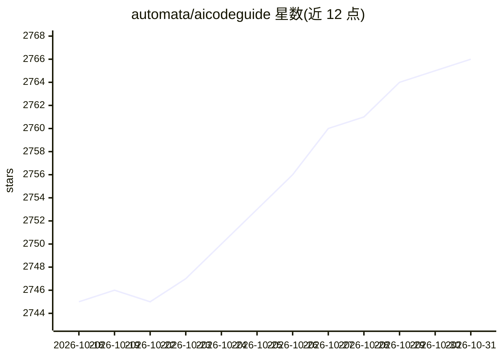

# automata/aicodeguide

⭐ 2,766 · 推送 2026-03-23 · [GitHub](https://github.com/automata/aicodeguide) · [官网](https://aicode.guide) · 个人维护

**AI 辅助编程入门路线图：教你用 AI/vibe coding 写代码**

由 Vilson Vieira 与 Eric S. Raymond 编写的英文指南文档，汇集 AI coding（AI 辅助代码生成）、vibe coding 与 agentic coding 的概念解释、工具选型建议（如 Claude Code、Cursor、Codex 及开源替代 Pi/OpenCode/OpenHands）和提示词工作流。面向尚未使用 AI 助手的程序员与零基础想通过 vibe coding 构建产品的用户；以 FAQ 形式组织，各节附持续更新的资源链接，含 PRD 编写、任务拆分与 AGENTS.md 实践。仅为文档，不含可运行代码。

## 筛选速览

| 维度 | 判定 | 备注 |
|---|---|---|
| AI 角色 | `ai-knowledge` | 知识聚合/清单类 |
| 许可风险 | `none` | — |
| 部署形态 | `library` | 以包/库形式分发 |
| 模型依赖 | — | README 未给出锁定关系 |
| 硬件要求 | — | 无带数字的原话,不猜 |
| 安装摩擦 | `low` | 无编译、无系统依赖或容器化 |
| 成熟度 | — | 结构信号不足 |

## 能力要点

- 区分并讲解 AI coding / vibe coding / agentic coding 三种实践
- 按编程经验分层推荐工具（网页工具、商业编辑器、开源替代）
- 给出从头脑风暴到 PRD/任务拆分的提示词工作流模板
- 每节附持续更新的资源列表，接受社区 PR 补充

## 适用场景

- 程序员入门 AI 编码助手并学习使用实践
- 零基础用户了解 vibe coding 并开始构建自己的产品
- 学习用 LLM 编写 PRD 与拆分任务的项目规划方法

## 场景标签

`教程课程` · 领域:学习与行业

## 证据(README 行号)

> L27: write this guide. It's our humble attempt to put everything together and present
> L129: # 🗺️ The Roadmap

## 星数曲线

2026-10-18 2,745 → 2026-10-31 2,766（+21）

---
*卡片 v1 · prompt 1.4 · 生成 2026-10-21 · 置信度 mid · 依据 README sha `e4461f69b17d` · [字段定义](../../DATASET.md)*
