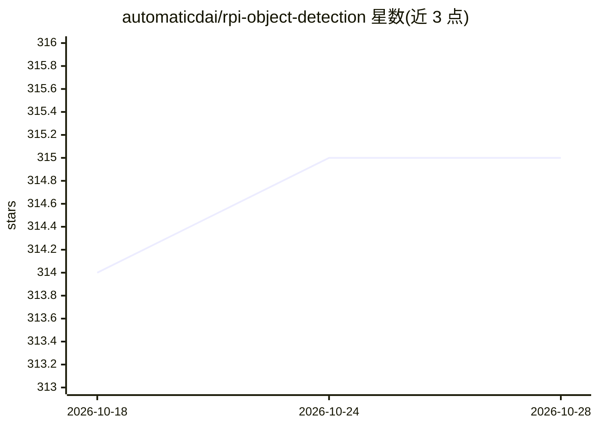

# automaticdai/rpi-object-detection

⭐ 315 · Python · MIT · 推送 2026-10-28 · [GitHub](https://github.com/automaticdai/rpi-object-detection) · 个人维护

**面向树莓派的实时目标检测与追踪示例集合**

基于 Python/OpenCV 的树莓派计算机视觉起步项目，提供 8 个独立示例：摄像头测试、运动检测（帧差+轮廓）、基于颜色/形状/ORB 特征的目标追踪、Haar 级联人脸检测，以及 YOLO（Ultralytics）和 TensorFlow Lite 两类神经网络目标检测。给 DIY/maker 开发者作为 RPi+CV 项目起点。代码跨平台，可跑在 x86/x64、Jetson、Banana Pi 等 Linux 平台；YOLO 与 TFLite 示例仅限 RPi 3/4/5。通过 install.sh 建虚拟环境安装依赖，逐脚本运行。

## 筛选速览

| 维度 | 判定 | 备注 |
|---|---|---|
| AI 角色 | `ai-native` | 本体是模型或模型工具 |
| 许可风险 | `permissive` | MIT |
| 部署形态 | `library` | 以包/库形式分发 |
| 模型依赖 | — | README 未给出锁定关系 |
| 硬件要求 | — | 无带数字的原话,不猜 |
| 安装摩擦 | `low` | 无编译、无系统依赖或容器化 |
| 成熟度 | — | 结构信号不足 |

## 能力要点

- 8 个独立 CV 示例：运动/颜色/形状/ORB 特征/人脸/YOLO/TFLite
- 支持树莓派 1/2/Zero/3/4/5 与 Nvidia Jetson（Nano 已测试）
- Picamera2 官方摄像头模块与 USB 摄像头均可接入
- install.sh 一键创建 venv 并安装全部 Python 依赖

## 适用场景

- 在树莓派上跑实时目标检测和追踪的 DIY 项目起步
- 对比颜色/形状/特征/深度学习多种检测方案的实现
- 在 Jetson 等其他 Linux 嵌入式板卡上复用这些 CV 示例

## 场景标签

`目标检测` `人脸识别` · 领域:感知与多模态

## 证据(README 行号)

> L49: - `src/object-detection-yolo`: Object detection using YOLO (RPi 3/4/5 only)
> L50: - `src/object-detection-tflite`: Object detection using TensorFlow Lite (RPi 3/4/5 only)
> L89: ### 3.7. Object Detection using YOLO

## 星数曲线

2026-10-18 314 → 2026-10-28 315（+1）

---
*卡片 v1 · prompt 1.4 · 生成 2026-10-21 · 置信度 mid · 依据 README sha `c943e2fd7f6a` · [字段定义](../../DATASET.md)*
