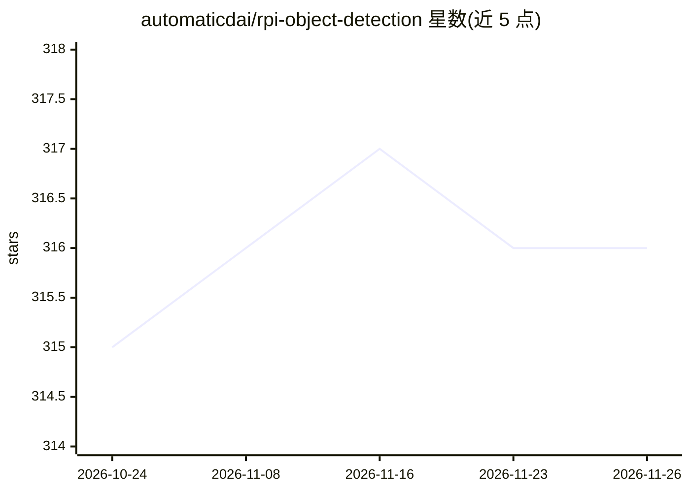

# automaticdai/rpi-object-detection

⭐ 316 · Python · MIT · 推送 2026-11-06 · [GitHub](https://github.com/automaticdai/rpi-object-detection) · 个人维护

**给树莓派开发者的实时目标检测与跟踪示例集**

基于 Python + OpenCV 的树莓派视觉示例仓库，提供相机测试、HTTP 视频流、运动检测、颜色/形状/ORB 特征三种跟踪、Haar 人脸检测，以及 Ultralytics YOLO 与 TensorFlow Lite 两类神经网络目标检测示例。代码跨平台，可在 x86/x64、Jetson、Banana Pi 等其他 Linux 板卡运行；通过 install.sh 创建 venv 并安装依赖，含各板卡 FPS 基准测试脚本。Jetson 特定功能需另用其姊妹仓库。

## 筛选速览

| 维度 | 判定 | 备注 |
|---|---|---|
| AI 角色 | `ai-native` | 本体是模型或模型工具 |
| 许可风险 | `permissive` | MIT |
| 部署形态 | `library` | 以包/库形式分发 |
| 模型依赖 | — | README 未给出锁定关系 |
| 硬件要求 | `cpu-ok` | |
| 安装摩擦 | `medium` | 含编译或系统依赖之一 |
| 成熟度 | — | 结构信号不足 |

## 能力要点

- 9 个示例覆盖相机测试到 YOLO/TFLite 目标检测
- 支持 Picamera2 自动切换 CSI 相机或 USB 相机
- install.sh 安装 CPU-only PyTorch 避免 ARM64 拉 GB 级 CUDA 包
- 提供各板卡 FPS 基准测试脚本与实测平台表

## 适用场景

- 为 DIY 树莓派视觉项目寻找入门起点
- 在 Pi 3/4/5 上跑 YOLO 或 TFLite 物体识别
- 用浏览器远程查看树莓派摄像头画面

## 场景标签

`目标检测` · 领域:感知与多模态

## 证据(README 行号)

> L12: Using a Raspberry Pi and a camera module for computer vision with OpenCV, YOLO, and TensorFlow Lite. The aim of thi
> L69: - `src/object-detection-yolo`: Object detection using YOLO (RPi 3/4/5 only)

## 星数曲线

2026-10-24 315 → 2026-11-26 316（+1）

---
*卡片 v1 · prompt 1.4 · 生成 2026-11-25 · 置信度 high · 依据 README sha `bef1b07b4161` · [字段定义](../../DATASET.md)*
