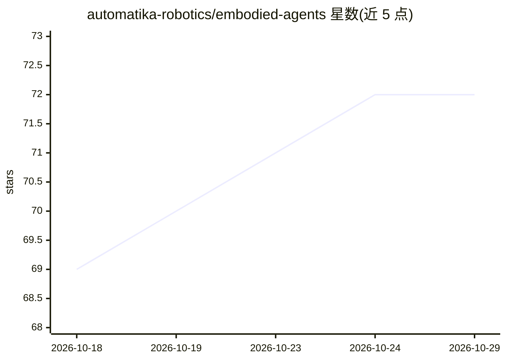

# automatika-robotics/embodied-agents

⭐ 72 · Python · MIT · 推送 2026-10-21 · [GitHub](https://github.com/automatika-robotics/embodied-agents) · [官网](https://emos.automatikarobotics.com) · 组织维护

**ROS 2 机器人具身智能框架：把模型组成可重配置的智能体**

基于 ROS 2 的物理 AI 框架，是 EMOS 系统的智能与操作层。开发者用一个 Python 文件（recipe）把 LLM/VLM、语音、视觉感知、记忆、规划（Cortex）与机械臂操作（MoveIt 2、VLA 策略）等组件连成图，组件为受生命周期管理的 ROS 2 节点，运行时可自我重配置。支持完全离线运行（llama.cpp、ONNX Runtime、sherpa-onnx），也可接 Ollama、vLLM 等模型服务器；由 Automatika Robotics 与 Inria 合作维护，MIT 许可。提供 apt 安装与源码安装两种方式，部分功能需额外包。

## 筛选速览

| 维度 | 判定 | 备注 |
|---|---|---|
| AI 角色 | `ai-ecosystem` | LLM/agent 周边工具 |
| 许可风险 | `permissive` | MIT |
| 部署形态 | `None` |  |
| 模型依赖 | local-ok | 支持本地模型 |
| 硬件要求 | — | 无带数字的原话,不猜 |
| 安装摩擦 | `low` | 无编译、无系统依赖或容器化 |
| 成熟度 | — | 结构信号不足 |

## 能力要点

- recipe 单文件定义组件图，运行时可重配置，自动生成 Web UI
- 完全离线本地模型路径（llama.cpp/ONNX Runtime/sherpa-onnx），面向边缘设备与 Jetson
- 支持 Ollama、vLLM、SGLang、LeRobot 策略服务器等多种模型服务
- MoveIt 2 经典操作与 GR00T/π0.5/SmolVLA/ACT 等 VLA 学习策略并用

## 适用场景

- 在机械臂机器人上搭建能看、听、说、记忆并规划的交互智能体
- 边缘设备或 Jetson 上完全离线部署机器人智能
- 用 VLM 监控 VLA 策略执行并通过事件结束任务

## 场景标签

`Agent 框架` · 领域:Agent 开发

## 证据(README 行号)

> L15: **EmbodiedAgents** is the intelligence and manipulation layer of EMOS, the Embodied Operating System. An agent is a
> L33: - **Run fully offline.** Built-in local models for LLM, VLM, detection, speech-to-text and text-to-speech (llama.cp
> L34: - **Any model server.** Ollama, OpenAI-compatible APIs (vLLM, SGLang, llama.cpp, LMDeploy), RoboML and the LeRobot 

## 星数曲线

2026-10-18 69 → 2026-10-29 72（+3）

---
*卡片 v1 · prompt 1.4 · 生成 2026-10-24 · 置信度 high · 依据 README sha `33ca33f2f663` · [字段定义](../../DATASET.md)*
