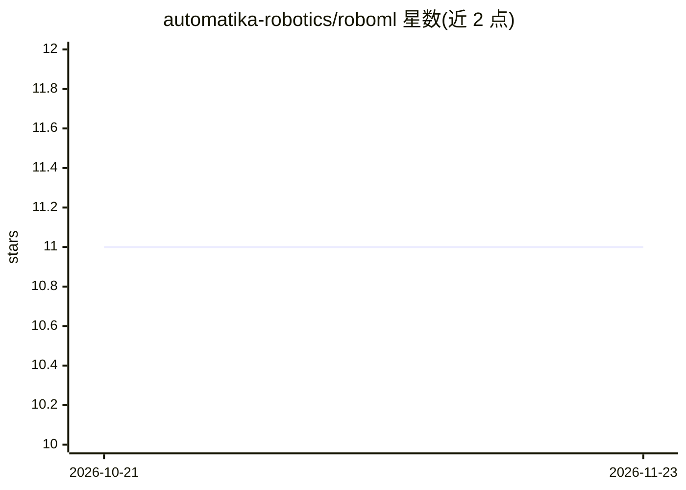

# automatika-robotics/roboml

⭐ 11 · Python · MIT · 推送 2026-09-03 · [GitHub](https://github.com/automatika-robotics/roboml) · 组织维护 · 中文 README

**为机器人快速部署开源 ML 模型的聚合库**

面向机器人场景的 ML 模型聚合与部署包，封装 HuggingFace Transformers 等库，提供 LLM、多模态视觉语言模型、检测+跟踪、语音识别与语音合成等模型类；通过 Ray Serve 将模型托管为可扩展服务端点，提供 WebSocket 流式端点与低延迟 RESP 服务器。默认从 HuggingFace 下载权重，可切换为 ModelScope（魔搭）源，对受限权重自动检测并提示 token 配置。已在 Ubuntu 20.04+ 测试，推荐 GPU 与 CUDA 12.1+。

## 筛选速览

| 维度 | 判定 | 备注 |
|---|---|---|
| AI 角色 | `ai-ecosystem` | LLM/agent 周边工具 |
| 许可风险 | `permissive` | MIT |
| 部署形态 | `self-host` | docker 或自建部署 |
| 模型依赖 | — | README 未给出锁定关系 |
| 硬件要求 | — | 无带数字的原话,不猜 |
| 安装摩擦 | `low` | 无编译、无系统依赖或容器化 |
| 成熟度 | — | 结构信号不足 |

## 能力要点

- 封装 Transformers 提供 LLM/MLLM/检测跟踪/ASR/TTS 六类模型包装器
- Ray Serve 托管模型为可扩展服务，另有 RESP 协议低延迟服务器
- 支持 HuggingFace 与 ModelScope 双源下载权重，自动检测受限检查点
- 检测模型可选集成 ByteTrack 目标跟踪

## 适用场景

- 为机器人系统快速部署开源大模型与多模态模型服务
- 在 ROS 规划控制流程中接入社区具身多模态模型
- 低延迟场景下通过 RESP 服务器传输图像音频二进制数据

## 场景标签

`语音合成` `语音识别` `多模态` `目标检测` · 领域:内容生成

## 证据(README 行号)

> L8: RoboML is an aggregator package for quickly deploying open-source ML models for robots. It supports three main use c
> L10: - **Rapid deployment of general-purpose models:** Wraps around popular ML libraries like 🤗 **Transformers**, allowi
> L99: RoboML uses Ray Serve to host models as scalable apps across various environments.

## 星数曲线

2026-10-21 11 → 2026-11-23 11（+0）

---
*卡片 v1 · prompt 1.4 · 生成 2026-11-18 · 置信度 high · 依据 README sha `c85a23499f3d` · [字段定义](../../DATASET.md)*
