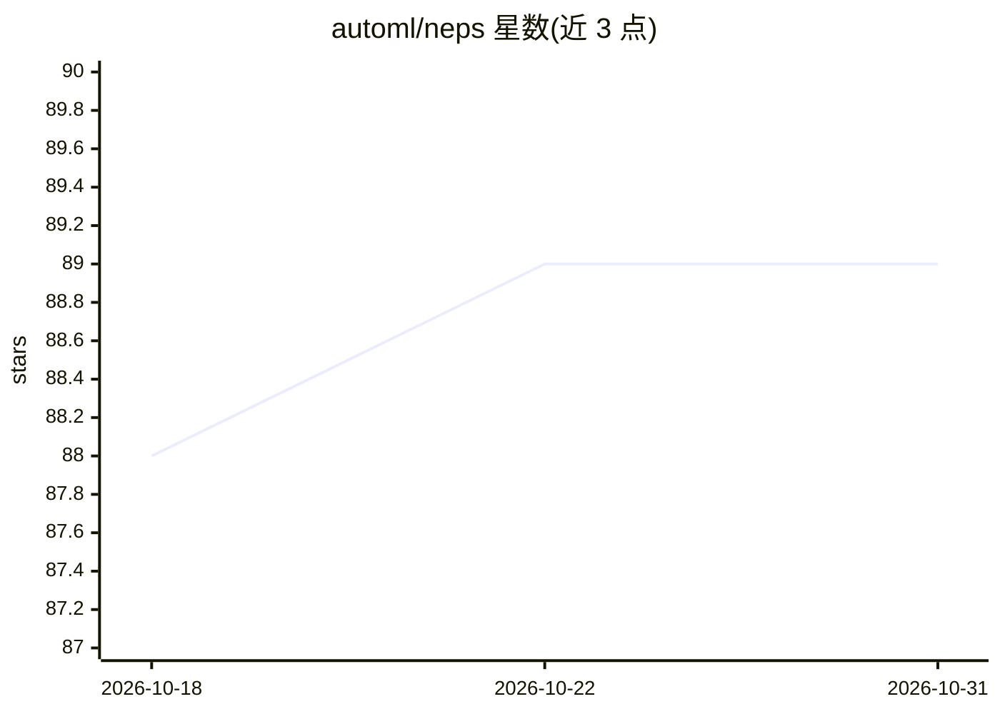

# automl/neps

⭐ 89 · Python · Apache-2.0 · 推送 2026-10-26 · [GitHub](https://github.com/automl/neps) · [官网](https://automl.github.io/neps/) · 组织维护

**面向深度学习专家的神经管线与超参数搜索工具**

NePS 是一个深度学习管线设计选择调优工具，支持超参数优化（HPO）、神经架构搜索（NAS）及其他管线设计选择，适用范围从单 GPU 到多节点、多集群。关键机制：与 DDP/FSDP 分布式训练配合，多 worker 通过共享结果目录自动协调、无需服务器；提供低保真评估、专家先验、贝叶斯优化等基于模型的搜索策略；支持任意设计空间、多种保真度维度与多目标优化；提供 neps.status 实时监控与干预。要求 Python 3.11-3.14，从 PyPI 安装。面向深度学习专家与 AutoML 用户。

## 筛选速览

| 维度 | 判定 | 备注 |
|---|---|---|
| AI 角色 | `ai-ecosystem` | LLM/agent 周边工具 |
| 许可风险 | `permissive` | Apache-2.0 |
| 部署形态 | `library` | 以包/库形式分发 |
| 模型依赖 | — | README 未给出锁定关系 |
| 硬件要求 | — | 无带数字的原话,不猜 |
| 安装摩擦 | `low` | 无编译、无系统依赖或容器化 |
| 成熟度 | — | 结构信号不足 |

## 能力要点

- 与 DDP/FSDP 配合的分布式模型调优，多节点开箱即用
- 多 worker 共享结果目录自动协调，无需设置服务器
- 低保真评估、专家先验、贝叶斯优化等搜索策略
- 支持任意设计空间、多保真度维度与多目标优化（PriMO）

## 适用场景

- 为深度学习模型做超参数优化或神经架构搜索
- 在多节点集群上并发调优十亿参数规模模型
- 用专家先验与既往研究结果加速搜索
- 同时优化多个目标（损失、下游任务、资源占用）

## 场景标签

`MLOps` · 领域:训练与推理

## 证据(README 行号)

> L8: NePS is a tool for tuning the design choices of deep learning pipelines efficiently and across scales.
> L9: Use it for hyperparameter optimization (HPO), neural architecture search (NAS), or any other design choice in your p
> L31: - **Any design space:** hyperparameters, architectures, resource allocation, or any component of the pipeline.

## 星数曲线

2026-10-18 88 → 2026-10-31 89（+1）

---
*卡片 v1 · prompt 1.4 · 生成 2026-10-23 · 置信度 high · 依据 README sha `1e7b7550435c` · [字段定义](../../DATASET.md)*
