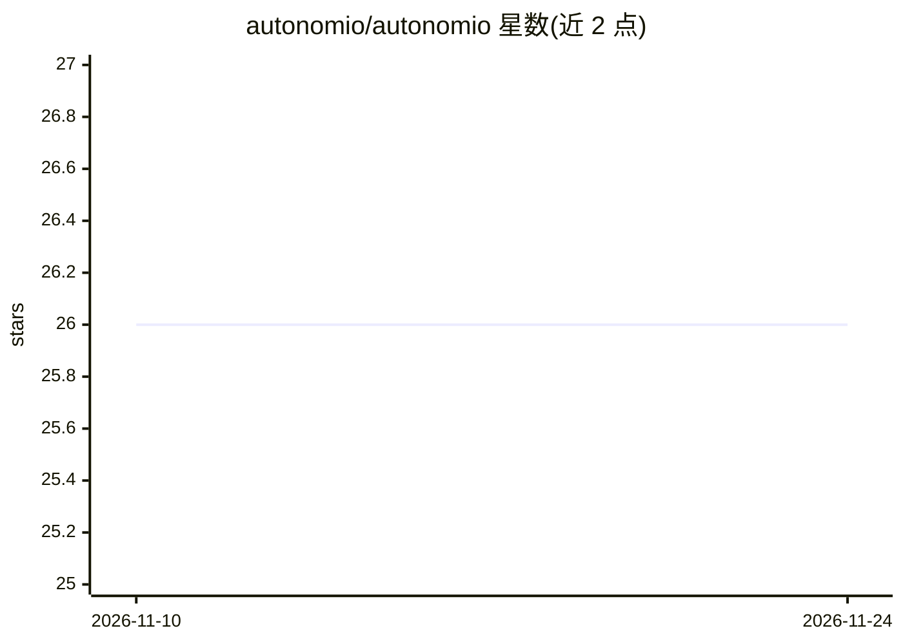

# autonomio/autonomio

⭐ 26 · Python · MIT · 推送 2026-10-22 · [GitHub](https://github.com/autonomio/autonomio) · [官网](http://autonom.io) · 组织维护

**面向数据科学的深度学习工作台库：单命令训练预测模型**

基于 Keras（TensorFlow 后端）与 spaCy 的 Python 高层抽象库，面向数据科学应用场景，通过单命令接口（train/predictor）创建 MLP、LSTM 与回归模型，内置超参数网格搜索（Hyperscan）、自动化数据变换、word2vec 词向量集成与交互式评估图表。官方给出情感分析、垃圾检测、欺诈检测等开箱即用场景，针对 Jupyter notebook 优化。README 标注示例更新停留在 2017 年 7 月。文本处理需至少 4GB 内存，生产环境另荐 CUDA GPU 实例。

## 筛选速览

| 维度 | 判定 | 备注 |
|---|---|---|
| AI 角色 | `ai-native` | 本体是模型或模型工具 |
| 许可风险 | `permissive` | MIT |
| 部署形态 | `library` | 以包/库形式分发 |
| 模型依赖 | — | README 未给出锁定关系 |
| 硬件要求 | — | 无带数字的原话,不猜 |
| 安装摩擦 | `medium` | 含编译或系统依赖之一 |
| 成熟度 | — | 结构信号不足 |

## 能力要点

- 单命令训练与预测接口（train/predictor）
- 支持 MLP、LSTM、回归模型与超参数网格搜索
- 自动化数据变换与 word2vec 词向量集成
- 深度学习模型评估的交互式图表

## 适用场景

- 在 Jupyter 中快速试验数据科学建模想法
- 做情感分析、垃圾检测、欺诈检测等分类任务
- 文本与表格数据上快速训练并预测结果

## 场景标签

`数据分析` · 领域:效率与自动化

## 证据(README 行号)

> L3: Autonomio provides a very high level abstraction layer for rapidly testing research ideas and instantly creating neu
> L36: - create MLP, LSTM and Regression models

## 星数曲线

2026-11-10 26 → 2026-11-24 26（+0）

---
*卡片 v1 · prompt 1.4 · 生成 2026-11-18 · 置信度 high · 依据 README sha `cc816de46716` · [字段定义](../../DATASET.md)*
