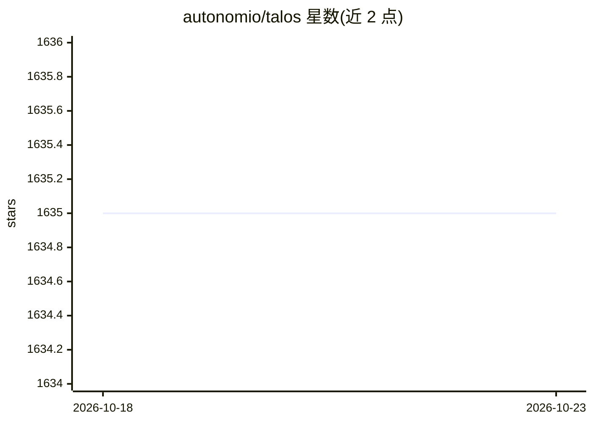

# autonomio/talos

⭐ 1,635 · Python · MIT · 推送 2026-10-22 · [GitHub](https://github.com/autonomio/talos) · [官网](https://autonom.io) · 组织维护

**Keras/TensorFlow/PyTorch 超参数实验与可复现记录工具**

面向研究者、数据科学家与数据工程师的超参数实验库：用户保留自己的 Keras、TensorFlow 或 PyTorch 模型与训练代码，Talos 以 Scan 接口在 notebook 中运行候选参数组合，记录训练历史、内容寻址清单、检查点与干预记录，并支持检查、选择与恢复已训练模型。支持网格与采样搜索、单文件实验定义与 CLI。通过 PyPI 安装，核心支持 Python 3.10-3.13；旧 1.x 版本需固定在 Python 3.10/3.11 且依赖 TensorFlow 2.14.1，将维护至至少 2028 年。

## 筛选速览

| 维度 | 判定 | 备注 |
|---|---|---|
| AI 角色 | `ai-ecosystem` | LLM/agent 周边工具 |
| 许可风险 | `permissive` | MIT |
| 部署形态 | `library` | 以包/库形式分发 |
| 模型依赖 | — | README 未给出锁定关系 |
| 硬件要求 | — | 无带数字的原话,不猜 |
| 安装摩擦 | `low` | 无编译、无系统依赖或容器化 |
| 成熟度 | — | 结构信号不足 |

## 能力要点

- Scan/Analyze/Predict/Evaluate/Deploy/Restore 接口
- 网格与采样搜索、reducer 与自定义策略
- 内容寻址清单与试验历史、检查点、干预记录
- Keras/TensorFlow/PyTorch 框架导入可选

## 适用场景

- 在 notebook 中对已有 Keras/PyTorch 模型做参数扫描
- 将参数实验固化为单文件定义与清单以便复现
- 从历史实验中恢复选定的已训练模型

## 场景标签

`MLOps` · 领域:训练与推理

## 证据(README 行号)

> L5: Hyperparameter experiments with Keras, TensorFlow and PyTorch.
> L14: Talos helps you turn the model you already have into a repeatable parameter experiment. You keep control of your Ke
> L16: Talos is made for researchers, data scientists and data engineers who want to remain in complete control of their m

## 星数曲线

2026-10-18 1,635 → 2026-10-23 1,635（+0）

---
*卡片 v1 · prompt 1.4 · 生成 2026-10-21 · 置信度 high · 依据 README sha `15bc67bc2d0c` · [字段定义](../../DATASET.md)*
