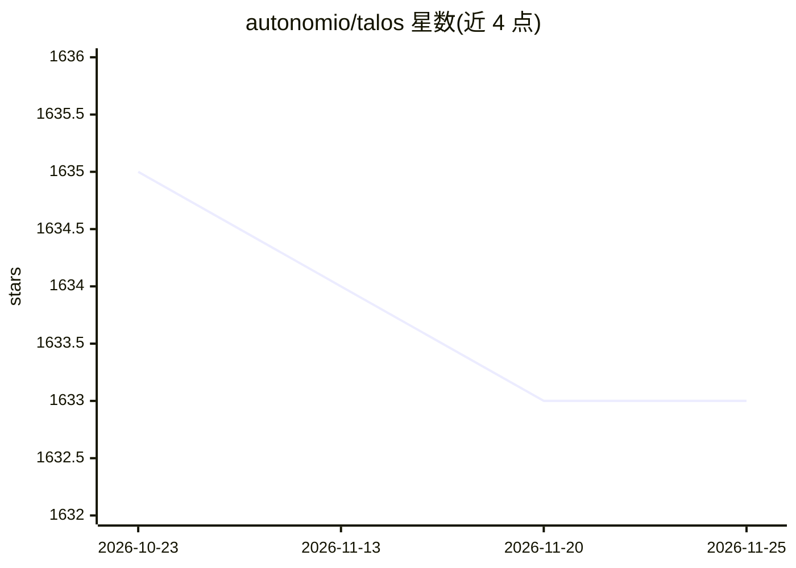

# autonomio/talos

⭐ 1,633 · Python · MIT · 推送 2026-11-13 · [GitHub](https://github.com/autonomio/talos) · [官网](https://autonom.io) · 组织维护

**为 Keras/TF/PyTorch 模型提供超参数实验管理的研究者工具**

Talos 将用户已有的 Keras、TensorFlow/tf.keras 或 PyTorch 模型包装成可复现的参数实验：用户保留模型与训练代码的控制权，Talos 运行候选参数组合、记录训练历史，并提供 Scan、Analyze/Reporting、Predict、Evaluate、Deploy、Restore 等接口用于检查、选择与恢复训练好的模型。支持网格与采样搜索、reducer、自定义策略，实验通过内容寻址清单、trial 历史、checkpoint 等机制记录。面向研究者、数据科学家与数据工程师，可在 notebook 中起步，也可用单文件定义加 CLI 运行。注意 1.x 与 2.x 分属不同代系，1.x 依赖 Python 3.10/3.11 环境与 TensorFlow 2.14.1。

## 筛选速览

| 维度 | 判定 | 备注 |
|---|---|---|
| AI 角色 | `ai-ecosystem` | LLM/agent 周边工具 |
| 许可风险 | `permissive` | MIT |
| 部署形态 | `library` | 以包/库形式分发 |
| 模型依赖 | — | README 未给出锁定关系 |
| 硬件要求 | — | 无带数字的原话,不猜 |
| 安装摩擦 | `low` | 无编译、无系统依赖或容器化 |
| 成熟度 | — | 结构信号不足 |

## 能力要点

- Scan/Analyze/Predict/Evaluate/Deploy/Restore 接口覆盖实验全流程
- 网格与采样搜索、reducer、自定义策略与本地控制文件
- 内容寻址清单、trial 历史、checkpoint 与干预记录保证实验可复现
- Keras、TensorFlow/tf.keras 与 PyTorch 支持，框架导入保持可选

## 适用场景

- 对已有 Keras 模型做系统性的参数扫描并记录历史
- 在 notebook 中快速上手超参数实验，再迁移到单文件+CLI 的可复现流程
- 从多次试验中挑选并恢复最佳训练模型用于部署
- 在论文中保留完整实验参数与数据溯源信息以便复现

## 场景标签

`MLOps` · 领域:训练与推理

## 证据(README 行号)

> L14: Talos helps you turn the model you already have into a repeatable parameter experiment. You keep control of your Ke
> L16: Talos is made for researchers, data scientists and data engineers who want to remain in complete control of their m
> L22: - Keras, TensorFlow/tf.keras and PyTorch, with framework imports kept optional.

## 星数曲线

2026-10-23 1,635 → 2026-11-25 1,633（-2）

---
*卡片 v1 · prompt 1.4 · 生成 2026-11-24 · 置信度 high · 依据 README sha `c4f716bad15d` · [字段定义](../../DATASET.md)*
