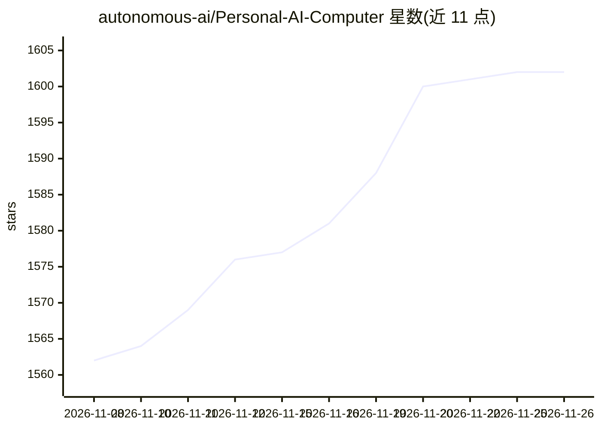

# autonomous-ai/Personal-AI-Computer

⭐ 1,602 · MIT · 推送 2026-11-05 · [GitHub](https://github.com/autonomous-ai/Personal-AI-Computer) · [官网](https://autonomous.ai/computer) · 组织维护

**开源硬件仓库：2-8 GPU 本地 AI 计算机的设计与搭建指南**

发布五套 Personal AI Computer 完整构建方案（2×/4× RTX 5090 与 2×/4× RTX PRO 6000、8× 5090 机架版），开源 CAD、BOM、BIOS 设置与装配照片，覆盖从 64 GB 到 384 GB VRAM 的本地推理、微调场景。软件层不绑定引擎：可配 Grid 编排器，或 vLLM/Ollama/llama.cpp。同时销售带 PCIe 延长线的机箱套件并提供免费兼容性检查。代码部分以 MIT 许可开源。

## 筛选速览

| 维度 | 判定 | 备注 |
|---|---|---|
| AI 角色 | `ai-ecosystem` | LLM/agent 周边工具 |
| 许可风险 | `permissive` | MIT |
| 部署形态 | `None` |  |
| 模型依赖 | local-ok | 支持本地模型 |
| 硬件要求 | `gpu-24g` | |
| 安装摩擦 | `medium` | 含编译或系统依赖之一 |
| 成熟度 | — | 结构信号不足 |

## 能力要点

- 五套 2-8 GPU 构建方案，含 CAD、BOM、BIOS 设置与装配照片
- VRAM 覆盖 64 GB–384 GB，支持以原始精度运行大参数开源模型
- 软件层兼容 vLLM、Ollama、llama.cpp 或 Grid 编排器
- 配套 BIOS 调优与多 GPU 稳定性测试流程

## 适用场景

- 自行搭建多 GPU 本地 LLM 推理/微调工作站
- 团队或企业部署私有化、无 API 计费的模型服务器
- 获取多 GPU 机箱与 PCIe 延长线套件并做配件兼容检查

## 场景标签

 · 领域:硬件/本地 AI 基础设施

## 证据(README 行号)

> L21: Open software lets you run and shape your AI; open hardware lets you build, repair, and improve the machine it runs
> L24: - **Open Source Software — your choice.** The easiest way is Grid, the open orchestrator for local AI — but any loc

## 星数曲线

2026-11-08 1,562 → 2026-11-26 1,602（+40）

---
*卡片 v1 · prompt 1.4 · 生成 2026-11-17 · 置信度 high · 依据 README sha `7702d477692c` · [字段定义](../../DATASET.md)*
