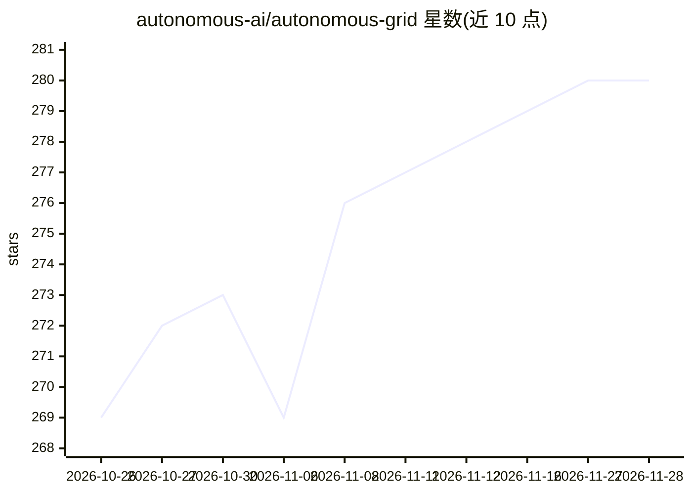

# autonomous-ai/autonomous-grid

⭐ 280 · Python · MIT · 推送 2026-11-12 · [GitHub](https://github.com/autonomous-ai/autonomous-grid) · [官网](https://www.autonomous.ai/grid) · 组织维护

**把家里多台电脑组成本地模型内网，统一 OpenAI 端点**

Grid 是一个本地分布式推理编排 CLI：将用户已有的多台电脑组成一个网格，对外暴露单一 OpenAI 兼容端点，并按请求路由到持有对应模型的机器。它内置 llama.cpp 引擎安装器（Metal/Vulkan/CPU 自动选择，CUDA 可从源码编译），也能把已运行的 Ollama、vLLM、LM Studio 作为后端接入。主机格仅做路由，无需显卡；支持 GGUF 模型下载（含视觉模型双文件自动获取）、远程模式跨网络组网、多网格管理，以及为 OpenClaw/Hermes/OpenAI SDK 提供接入配置。

## 筛选速览

| 维度 | 判定 | 备注 |
|---|---|---|
| AI 角色 | `ai-ecosystem` | LLM/agent 周边工具 |
| 许可风险 | `permissive` | MIT |
| 部署形态 | `None` |  |
| 模型依赖 | local-ok | 支持本地模型 |
| 硬件要求 | — | 无带数字的原话,不猜 |
| 安装摩擦 | `medium` | 含编译或系统依赖之一 |
| 成熟度 | — | 结构信号不足 |

## 能力要点

- 单一 OpenAI 兼容端点，请求路由到持有对应模型的机器
- 内置引擎安装器按机器选择 Metal/Vulkan/CPU 构建，CUDA 可源码编译
- 可接入已运行的 Ollama、vLLM 或 LM Studio，仅做路由不替换
- 支持本地/远程模式、多网格、视觉模型与 Hugging Face 任意 GGUF 仓库拉取

## 适用场景

- 把家中多台 Mac/PC 组成本地模型池，统一给应用调用
- 已有 Ollama/vLLM/LM Studio 的机器纳入同一入口统一调度
- 为 OpenClaw、Hermes 或自写代码提供本地 OpenAI 端点
- 不同地点的电脑通过远程模式组成一个推理网格

## 场景标签

`模型网关` `推理引擎` · 领域:Agent 开发

## 证据(README 行号)

> L11: **Grid** puts every computer you own behind one OpenAI-compatible endpoint, and sends each request
> L17: If you already run Ollama, vLLM or LM Studio, keep them — Grid networks them, it does not replace them.
> L121: - **engine** — the program that runs a model. Grid installs one for you.

## 星数曲线

2026-10-26 269 → 2026-11-28 280（+11）

---
*卡片 v1 · prompt 1.4 · 生成 2026-11-25 · 置信度 high · 依据 README sha `31bc30128bc3` · [字段定义](../../DATASET.md)*
