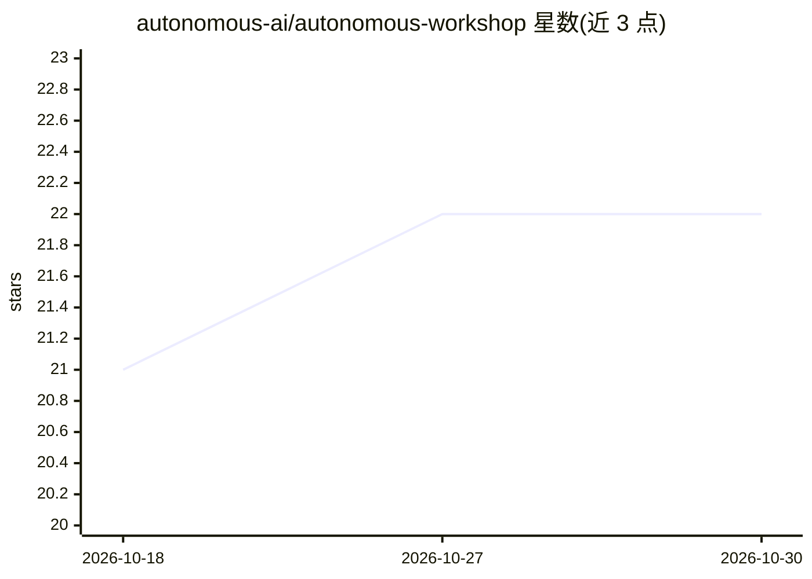

# autonomous-ai/autonomous-workshop

⭐ 22 · Python · Apache-2.0 · 推送 2026-10-29 · [GitHub](https://github.com/autonomous-ai/autonomous-workshop) · [官网](www.autonomous.ai/toys) · 组织维护

**让用户创建并指挥自主 AI 发明家持续设计玩具与游戏的引擎**

面向玩具与游戏品类的自主 AI 发明引擎：创建者通过对话与可编辑的 TASTE.md 塑造每个 Inventor 的品味与方向，Inventor 循环执行 Daydream→Invent→Make→Release→Shop 流程，生成玩具设计与 CAD 产物并发布到商店，实体生产与物流由 Operations 负责。提供 CLI：workshop create/start/daydream/wish/fix/publish 等命令，支持 Codex 作为 Workshop Manager、多种 workflow（Spark/Forge/Quest）、参考图附加与修正链。托管版 Manage Inventors 页面与学习回路为规划中功能。

## 筛选速览

| 维度 | 判定 | 备注 |
|---|---|---|
| AI 角色 | `ai-native` | 本体是模型或模型工具 |
| 许可风险 | `permissive` | Apache-2.0 |
| 部署形态 | `None` |  |
| 模型依赖 | — | README 未给出锁定关系 |
| 硬件要求 | — | 无带数字的原话,不猜 |
| 安装摩擦 | `low` | 无编译、无系统依赖或容器化 |
| 成熟度 | `idea` | |

## 能力要点

- Inventor 持久工作区：Chat 对话、TASTE.md 品味、Inventions 玩具库
- workshop start 循环：做梦→构建→发布，可 --once/--max-ideas/--workflow 控制
- workshop fix 修正链与 --no-publish 本地封存、事后 publish 原样发布
- 发布凭证不进入浏览器 URL 或 agent 会话的凭据隔离机制

## 适用场景

- 创建多个不同品味的 AI 发明家并持续产出玩具创意
- 提交自己的 toy brief 让指定 Inventor 制作单个产品
- 对已发布玩具做单点修正并按需重新发布

## 场景标签

`Agent 框架` `多智能体` · 领域:Agent 开发

## 证据(README 行号)

> L11: Create your own autonomous AI Inventor. Shape its Taste, give it direction, and let it dream up and develop origina
> L17: The Autonomous Workshop loop: Daydream, Invent (optional), Make, Playtest (optional), Release, Shop, Scoreboard
> L39: - **Available in the CLI:** `workshop create inventor --taste ./TASTE.md` creates a specialist bundle from your exa

## 星数曲线

2026-10-18 21 → 2026-10-30 22（+1）

---
*卡片 v1 · prompt 1.4 · 生成 2026-10-27 · 置信度 high · 依据 README sha `e6867f168d0b` · [字段定义](../../DATASET.md)*
