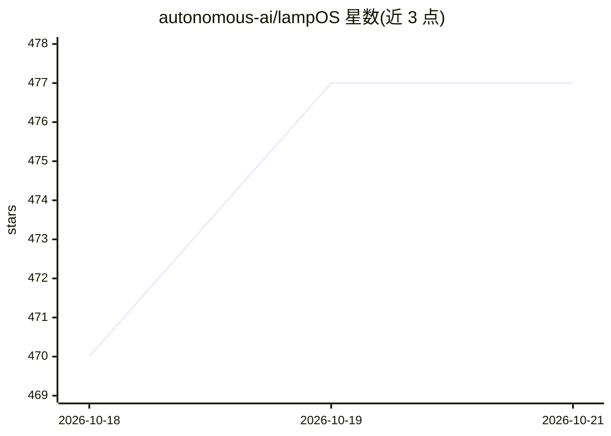

# autonomous-ai/lampOS

⭐ 486 · Python · Apache-2.0 · 推送 2026-10-22 · [GitHub](https://github.com/autonomous-ai/lampOS) · [官网](www.autonomous.ai/lamp) · 组织维护

**让 AI agent 控制实体机器人的开源操作系统**

面向实体 AI 的操作系统软件栈：把 Hermes、Claude Code、Codex 等 agent 运行时接入机器人本体（Lamp、Reachy Mini、Intern 或自描述硬件），协调摄像头、麦克风、电机、灯光等硬件。机器人用 ROBOT.md/SOUL.md/SAFETY.md/SKILL.md 四个 markdown 文件描述；技能以 SKILL.md 编写并经 Skill Store 分发；Go 守护进程 os-server 负责意图路由、硬件指令分发与安全钳制；HAL 支持 Gemini Live、OpenAI Realtime、Pipecat 等实时语音管线，推理可使用远端模型服务。支持 Raspberry Pi 4/5、CM4、OrangePi 4 Pro 等板卡，分层架构允许逐层替换。

## 筛选速览

| 维度 | 判定 | 备注 |
|---|---|---|
| AI 角色 | `ai-ecosystem` | LLM/agent 周边工具 |
| 许可风险 | `permissive` | Apache-2.0 |
| 部署形态 | `None` |  |
| 模型依赖 | — | README 未给出锁定关系 |
| 硬件要求 | — | 无带数字的原话,不猜 |
| 安装摩擦 | `low` | 无编译、无系统依赖或容器化 |
| 成熟度 | — | 结构信号不足 |

## 能力要点

- 六个 agent 运行时经统一 76 方法 AgentGateway 切换，persona/记忆/连接器随迁
- 机器人以四个 markdown 文件（ROBOT/SOUL/SAFETY/SKILL）定义，新板卡只需一条 JSON 条目
- SAFETY.md 安全门为纯函数钳制，位于所有请求路径且无模型参与
- HAL 实时语音支持 Gemini Live、OpenAI Realtime、GPT-Live、Pipecat v1

## 适用场景

- 给桌面机器人接入可控 agent，实现语音对话与硬件动作
- 在自有机器人硬件上描述四份 markdown 文件即可接入该 OS
- 通过 Harness/Buddy 让机器人委派任务给配对电脑上的 agent 或 Mac 应用

## 场景标签

`语音 Agent` · 领域:对话与助手

## 证据(README 行号)

> L15: Run Hermes, Claude Code, Codex, OpenClaw, OpenCode, or PicoClaw. Choose a compatible model and configure its voice,
> L139: The engine that thinks. Six of them — Hermes, OpenClaw, PicoClaw, Codex, Claude Code, OpenCode — behind one 76-met
> L143: The Go daemon `os-server` on :5000, one package per box in the figure. `intent` handles eligible voice and text-on

## 星数曲线

2026-10-18 470 → 2026-10-21 477（+7）

---
*卡片 v1 · prompt 1.4 · 生成 2026-10-22 · 置信度 high · 依据 README sha `f39ae5a61554` · [字段定义](../../DATASET.md)*
