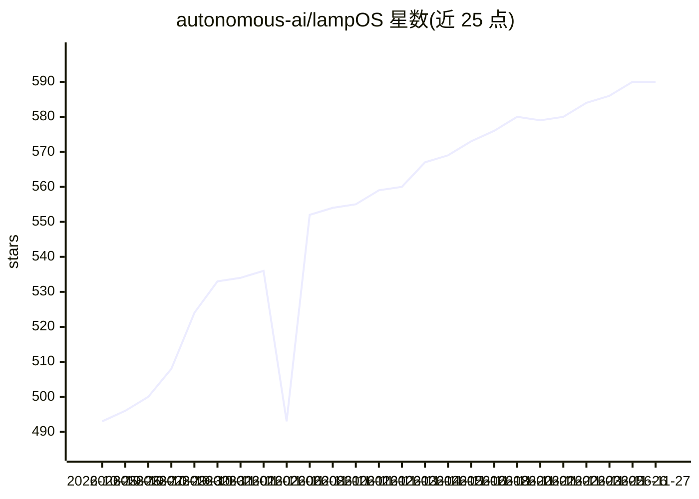

# autonomous-ai/lampOS

⭐ 590 · Rust · Apache-2.0 · 推送 2026-11-26 · [GitHub](https://github.com/autonomous-ai/lampOS) · [官网](www.autonomous.ai/lamp) · 组织维护

**让 AI agent 拥有身体与感知的机器人操作系统**

面向物理 AI agent 的开源操作系统：在 Lamp、Reachy Mini、Intern 等机器人上运行，协调摄像头、麦克风、扬声器、电机等硬件与 agent 任务。支持 Hermes、Claude Code、Codex、OpenClaw、OpenCode、PicoClaw 六种 agent 运行时，通过 76 方法 AgentGateway 统一封装，可在 Web UI 中切换。语音路径支持 Gemini Live、OpenAI Realtime、GPT-Live 与 Pipecat 管线；意图命令先走本地规则再经 Jev 校验回退。机器人硬件用四个 markdown 文件（ROBOT/SOUL/SAFETY/SKILL）描述，技能经 Skill Store 安装。Lamp 等经手机 App 配置，Reachy Mini 经 SSH 脚本安装。

## 筛选速览

| 维度 | 判定 | 备注 |
|---|---|---|
| AI 角色 | `ai-ecosystem` | LLM/agent 周边工具 |
| 许可风险 | `permissive` | Apache-2.0 |
| 部署形态 | `None` |  |
| 模型依赖 | — | README 未给出锁定关系 |
| 硬件要求 | — | 无带数字的原话,不猜 |
| 安装摩擦 | `low` | 无编译、无系统依赖或容器化 |
| 成熟度 | — | 结构信号不足 |

## 能力要点

- 六种 agent 运行时（Hermes/Claude Code/Codex 等）经统一 AgentGateway 可切换
- 四个 markdown 文件描述任意机器人（ROBOT/SOUL/SAFETY/SKILL）
- 语音路径支持 Gemini Live、OpenAI Realtime、GPT-Live、Pipecat
- 技能经 Skill Store 一键安装，可由自然语言生成

## 适用场景

- 给桌面机器人接上语音 agent，让它看、听、说、动
- 通过语音或聊天控制灯光、音量等设备命令
- 把编码/研究任务委派给配对电脑上的 Harness agent
- 为自己的机器人硬件接入 agent 能力

## 场景标签

`语音 Agent` · 领域:对话与助手

## 证据(README 行号)

> L16: # Physical AI Operating System
> L30: Run Hermes, Claude Code, Codex, OpenClaw, OpenCode, or PicoClaw. Choose a compatible model and configure its voice,
> L154: The engine that thinks. Six of them — Hermes, OpenClaw, PicoClaw, Codex, Claude Code, OpenCode — behind one 76-met

## 星数曲线

2026-10-25 493 → 2026-11-27 590（+97）

---
*卡片 v1 · prompt 1.4 · 生成 2026-11-25 · 置信度 high · 依据 README sha `1a1fdd59e76f` · [字段定义](../../DATASET.md)*
