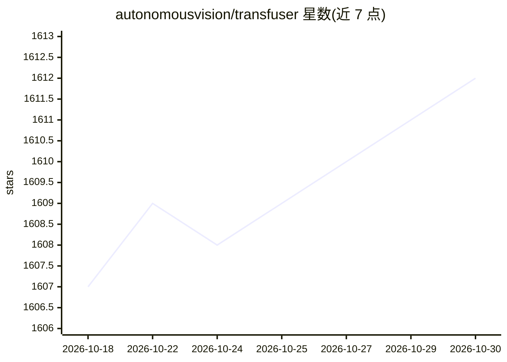

# autonomousvision/transfuser

⭐ 1,612 · Python · MIT · 推送 2026-09-21 · [GitHub](https://github.com/autonomousvision/transfuser) · 组织维护

**基于 Transformer 传感器融合的端到端自动驾驶模仿学习模型**

PAMI 2023 论文 TransFuser 的官方代码库，为 CVPR 2021 多模态融合 Transformer 工作的期刊扩展。方法通过 Transformer 融合相机图像与激光雷达等传感器数据，在 CARLA 仿真器中以模仿学习进行端到端自动驾驶训练。仓库提供数据生成 autopilot、210GB 训练数据下载脚本、单机/多 GPU 训练脚本、4 种方法的预训练权重，以及 Longest6 基准评测与 CARLA 排行榜 Docker 提交流程。运行需 CARLA 0.9.10.1 与 conda 环境，CVPR 版本代码在 cvpr2021 分支。

## 筛选速览

| 维度 | 判定 | 备注 |
|---|---|---|
| AI 角色 | `ai-native` | 本体是模型或模型工具 |
| 许可风险 | `permissive` | MIT |
| 部署形态 | `None` |  |
| 模型依赖 | — | README 未给出锁定关系 |
| 硬件要求 | — | 无带数字的原话,不猜 |
| 安装摩擦 | `low` | 无编译、无系统依赖或容器化 |
| 成熟度 | — | 结构信号不足 |

## 能力要点

- Transformer 融合多传感器（相机/激光雷达）的端到端驾驶模型
- 提供 210GB CARLA 训练数据集与数据生成脚本
- 4 种方法的预训练权重可从 AWS 下载
- 支持 Longest6 基准评测与 CARLA 排行榜 Docker 提交

## 适用场景

- 复现 TransFuser 论文的自动驾驶训练与评测
- 在 CARLA Longest6 基准上评测端到端驾驶模型
- 生成自动驾驶模仿学习训练数据

## 场景标签

 · 领域:自动驾驶/机器学习研究

## 证据(README 行号)

> L9: This repository contains the code for the PAMI 2023 paper TransFuser: Imitation with Transformer-Based Sensor Fusion
> L78: The code for training via imitation learning is provided in train.py. \

## 星数曲线

2026-10-18 1,607 → 2026-10-30 1,612（+5）

---
*卡片 v1 · prompt 1.4 · 生成 2026-10-21 · 置信度 high · 依据 README sha `40c4be82bc49` · [字段定义](../../DATASET.md)*
