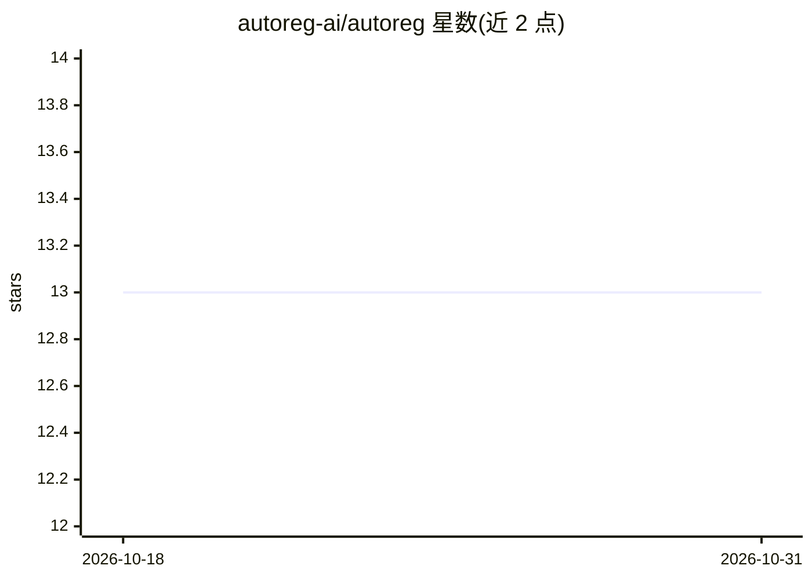

# autoreg-ai/autoreg

⭐ 13 · MDX · 推送 2026-10-19 · [GitHub](https://github.com/autoreg-ai/autoreg) · [官网](https://autoreg.sh) · 组织维护

**读取自然语言规格自动生成并自愈端到端测试的桌面应用**

测试自动化桌面应用（Windows/macOS）：通过编辑器内 AutoReg 技能读取应用程序并生成 autoreg.md 规格，AutoReg 据此打开应用、实时检视并生成测试场景与测试计划，支持一键运行；失败测试会被诊断、定位根因并自动重新生成。日常操作通过聊天面板以自然语言完成，测试以可手工编辑的 JSON 文件存储，运行产生日志、截图与可选录像。前置条件包括可访问的应用实例、测试凭据，以及运行 AI 编码代理（如 Claude Code、Cursor）的 VS Code 兼容编辑器。

## 筛选速览

| 维度 | 判定 | 备注 |
|---|---|---|
| AI 角色 | `ai-native` | 本体是模型或模型工具 |
| 许可风险 | `none` | — |
| 部署形态 | `desktop` | 安装包/桌面程序 |
| 模型依赖 | — | README 未给出锁定关系 |
| 硬件要求 | — | 无带数字的原话,不猜 |
| 安装摩擦 | `low` | 无编译、无系统依赖或容器化 |
| 成熟度 | — | 结构信号不足 |

## 能力要点

- 由 AI 技能读取应用生成 autoreg.md 规格，再生成完整测试套件
- 失败测试自动诊断根因并重新生成（Autoheal）
- 聊天面板自然语言执行生成/运行/修复/编辑测试
- 测试为纯 JSON 步骤文件，可手工编辑；运行产出日志、截图与可选录像

## 适用场景

- 我想为我的应用自动生成一套端到端测试
- 测试因界面改动失败时，让工具自动修复而不是手工改脚本
- 通过对话让 AI 帮我新增或调整测试场景

## 场景标签

`编码 Agent` · 领域:编码与开发

## 证据(README 行号)

> L3: AutoReg is a test automation desktop app that reads a plain-language spec of your application, generates a complete 
> L10: |**2. Generate**|AutoReg opens your app, inspects it live, and generates a full set of test scenarios|
> L42: 5. **Autoheal failures** — if a test fails, ask AutoReg to fix it and it will diagnose the failure and regenerate t

## 星数曲线

2026-10-18 13 → 2026-10-31 13（+0）

---
*卡片 v1 · prompt 1.4 · 生成 2026-10-31 · 置信度 high · 依据 README sha `38a274e654aa` · [字段定义](../../DATASET.md)*
