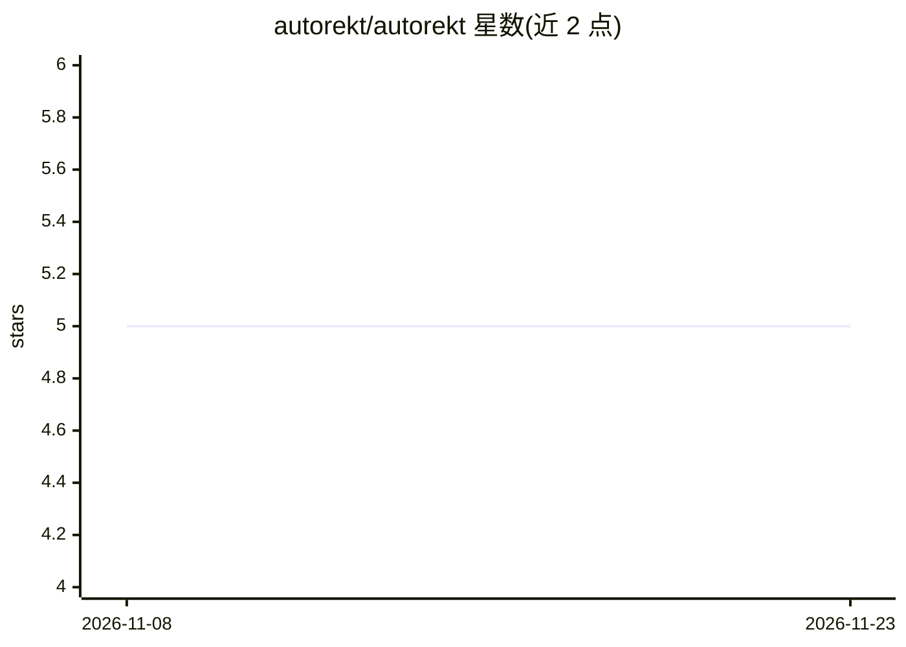

# autorekt/autorekt

⭐ 5 · Rust · MIT · 推送 2026-11-14 · [GitHub](https://github.com/autorekt/autorekt) · [官网](https://autorekt.com) · 个人维护 · 中文 README

**给 AI 代理提供免费市场数据的 CLI 工具**

autorekt 是一个 Rust 编写的 CLI，从 OKX、Binance、Yahoo Finance、Cboe、Kalshi 等公开数据源抓取价格、美元流动性、掉期利差、持仓、期权 gamma、预测市场赔率与新闻，输出为紧凑文本供 AI 代理读取。接口由 show、search、watch 三个命令构成，支持基于表达式的规则回测与后台守护进程告警；本地运行，无账号与 API key，不做交易。安装方式为预编译脚本或 cargo 从源码构建。

## 筛选速览

| 维度 | 判定 | 备注 |
|---|---|---|
| AI 角色 | `ai-ecosystem` | LLM/agent 周边工具 |
| 许可风险 | `permissive` | MIT |
| 部署形态 | `None` |  |
| 模型依赖 | — | README 未给出锁定关系 |
| 硬件要求 | — | 无带数字的原话,不猜 |
| 安装摩擦 | `medium` | 含编译或系统依赖之一 |
| 成熟度 | — | 结构信号不足 |

## 能力要点

- show/search/watch 三个命令覆盖读取、检索、告警
- 规则支持历史回测（--test），由守护进程执行并触发 hook
- 数据全部来自公开端点，本地缓存与限速，无遥测
- 支持 CSV/Markdown 导出与 Pine Script 风格指标列

## 适用场景

- 让 Claude Code 等代理在分析行情前读取最新市场简报
- 对加密货币或股票的异常波动做归因分析
- 设定价格/赔率规则在触发时唤醒代理

## 场景标签

`金融量化` · 领域:学习与行业

## 证据(README 行号)

> L5: **Make your AI a Wall Street analyst.**
> L8: autorekt hands your agent the whole tape: prices across every asset class, dollar liquidity, swap
> L147: per job, the same options everywhere, and help and error messages that say what to do next.

## 星数曲线

2026-11-08 5 → 2026-11-23 5（+0）

---
*卡片 v1 · prompt 1.4 · 生成 2026-11-21 · 置信度 high · 依据 README sha `9b0575e7536a` · [字段定义](../../DATASET.md)*
