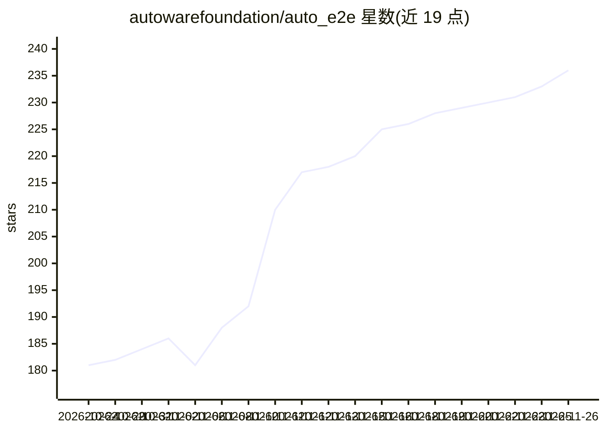

# autowarefoundation/auto_e2e

⭐ 236 · Python · Apache-2.0 · 推送 2026-11-19 · [GitHub](https://github.com/autowarefoundation/auto_e2e) · [官网](https://autoware.org) · 组织维护

**面向自动驾驶的开源端到端摄像头轨迹规划模型**

Autoware 基金会开发的相机优先端到端驾驶模型：从 6 个环视相机直接生成 6.4 秒车辆轨迹，79.9M 参数、10 Hz 推理，无需 HD 地图。由 Reactive（10 Hz 规划）、World Action 与 Reasoning（1 Hz，开发中）三个模型组成。代码 Apache-2.0，检查点因训练数据许可为 CC BY-NC-SA/NC 4.0 仅限非商业使用。提供 Hugging Face 权重、DataModelConsole 回放面板、基准对比与 AWS EC2 测试指南。

## 筛选速览

| 维度 | 判定 | 备注 |
|---|---|---|
| AI 角色 | `ai-native` | 本体是模型或模型工具 |
| 许可风险 | `permissive` | Apache-2.0 |
| 部署形态 | `library` | 以包/库形式分发 |
| 模型依赖 | — | README 未给出锁定关系 |
| 硬件要求 | — | 无带数字的原话,不猜 |
| 安装摩擦 | `medium` | 含编译或系统依赖之一 |
| 成熟度 | — | 结构信号不足 |

## 能力要点

- 6 相机输入、10 Hz、6.4 秒轨迹的端到端规划（79.9M 参数）
- 提供 Hugging Face 上的 nuplan/kitscenes 两套检查点
- DataModelConsole 只读面板回放相机、真值与预测轨迹
- 与 8 个开放权重模型的 ADE/FDE 开环基准对比

## 适用场景

- 作为 Robotaxi 规划模型与 LiDAR/雷达安全层融合使用
- 仅用相机运行 L2++ 免 hand ADAS 场景
- 在新城市数据上做零样本推理或自有数据微调
- 复现端到端驾驶模型的开环基准评测

## 场景标签

`模型评测` `微调` · 领域:评测与运维

## 证据(README 行号)

> L9:  An open-source, camera-first End-to-End driving model for highways, arterial roads and city streets.
> L19: AutoE2E plans the vehicle's trajectory directly from surround cameras. Fuse its output with LiDAR and radar safety 
> L27: AutoE2E is three cooperating models. The **Reactive model** runs at 10 Hz and drives: it lifts six surround cameras

## 星数曲线

2026-10-24 181 → 2026-11-26 236（+55）

---
*卡片 v1 · prompt 1.4 · 生成 2026-11-25 · 置信度 high · 依据 README sha `4e0c1c6f3c7a` · [字段定义](../../DATASET.md)*
