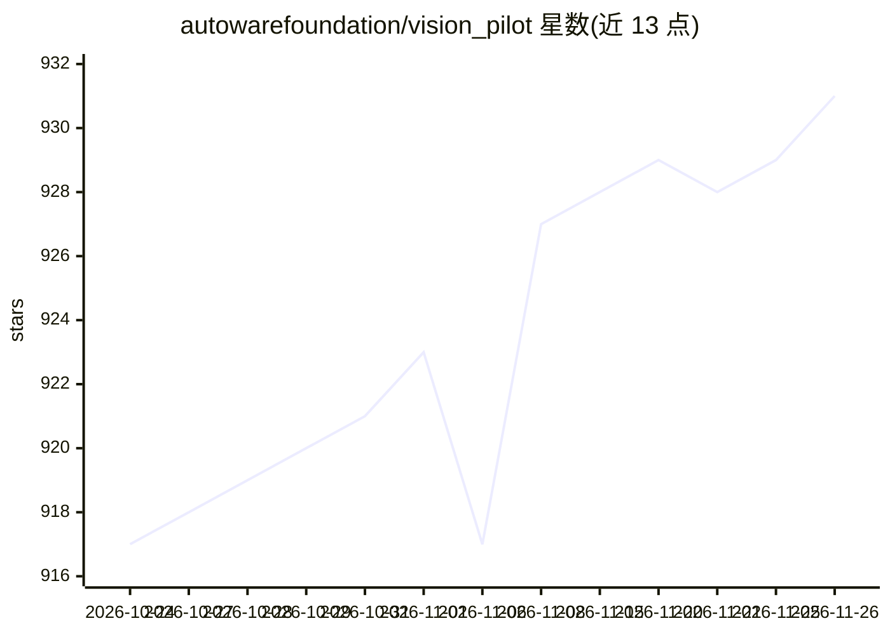

# autowarefoundation/vision_pilot

⭐ 931 · C++ · Apache-2.0 · 推送 2026-11-25 · [GitHub](https://github.com/autowarefoundation/vision_pilot) · [官网](https://autoware.org/) · 组织维护

**开源端到端 AI 的 L2 ADAS 驾驶辅助软件栈**

由 Autoware Foundation 发布的开源 L2 ADAS 系统，采用混合端到端 AI 架构：感知模型（AutoSpeed 物体检测）负责安全、端到端模型（AutoSteer/AutoDrive）负责性能，三个模型权重随代码一并开源。支持 ACC/FCW/AEB/LKAS/LDW/ISA 与单车道免手扶高速 Autopilot，仅需一个 52-55° 视场角的前置单目摄像头，无需高精地图，实时以 mapless 模式跟随道路。面向 OEM 与 Tier-1 量产集成，可扩展至公交与卡车场景。提供源码编译、预构建 DEB 包与 Docker 三种运行方式，支持 ROS 2 与 CARLA 仿真闭环测试。

## 筛选速览

| 维度 | 判定 | 备注 |
|---|---|---|
| AI 角色 | `ai-native` | 本体是模型或模型工具 |
| 许可风险 | `permissive` | Apache-2.0 |
| 部署形态 | `desktop` | 安装包/桌面程序 |
| 模型依赖 | — | README 未给出锁定关系 |
| 硬件要求 | — | 无带数字的原话,不猜 |
| 安装摩擦 | `low` | 无编译、无系统依赖或容器化 |
| 成熟度 | — | 结构信号不足 |

## 能力要点

- 混合端到端架构：感知模型与端到端模型并行处理
- 三个开源模型（AutoSpeed/AutoSteer/AutoDrive）含权重，Apache 2.0 许可
- 单目摄像头运行，无需 3D 高精地图
- 支持 CARLA 0.9.16 仿真闭环测试与 ROS 2 接口

## 适用场景

- 在乘用车上集成入门级 L2 驾驶辅助功能（ACC/LKAS/AEB 等）
- 用 CARLA 仿真环境做闭环验证与评估
- 用示例数据集做开环场景测试与可视化
- 面向公交、卡车等运输物流场景做适配

## 场景标签

`目标检测` · 领域:感知与多模态

## 证据(README 行号)

> L52: perception AI models for safety, and End-to-End AI models for performance.
> L56: 1. AutoSpeed - Closest in-path object detection
> L63: **Vision Pilot does not require 3D high definition maps** and operates in a 'mapless' mode to follow the road in

## 星数曲线

2026-10-24 917 → 2026-11-26 931（+14）

---
*卡片 v1 · prompt 1.4 · 生成 2026-11-25 · 置信度 high · 依据 README sha `ecee4eb8e14d` · [字段定义](../../DATASET.md)*
