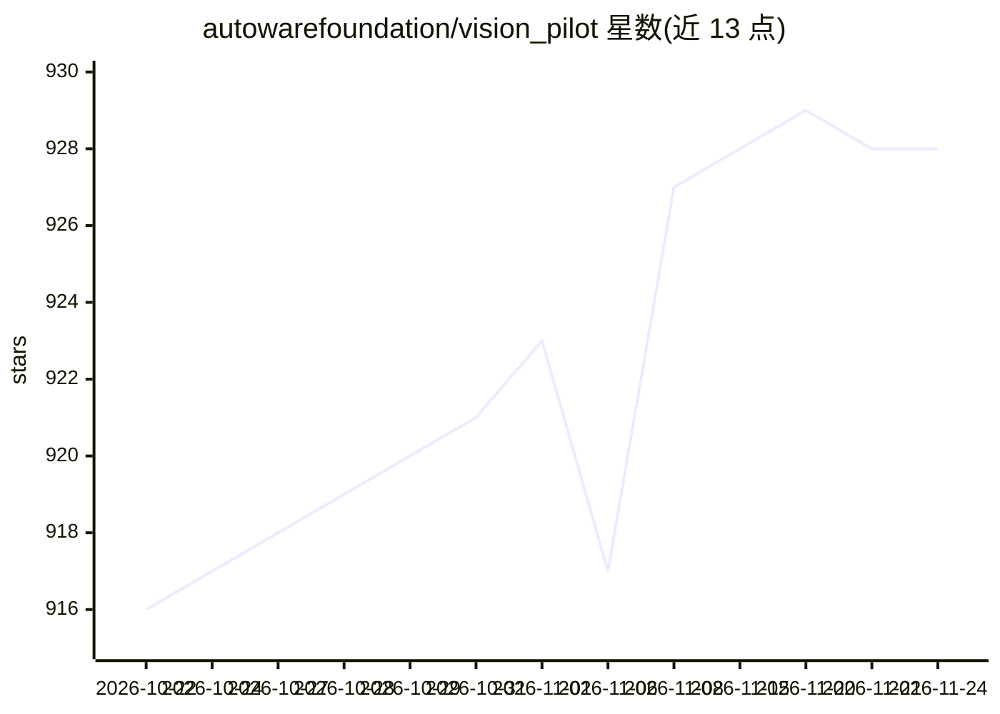

# autowarefoundation/vision_pilot

⭐ 928 · C++ · Apache-2.0 · 推送 2026-11-20 · [GitHub](https://github.com/autowarefoundation/vision_pilot) · [官网](https://autoware.org/) · 组织维护

**开源端到端 AI 的 L2 ADAS 驾驶辅助系统**

Autoware Foundation 发布的开源 L2 级高级驾驶辅助系统（ADAS）软件栈，采用混合端到端 AI 架构：感知模型（AutoSpeed 目标检测）负责安全，端到端模型（AutoSteer 车道点检测、AutoDrive 车距/弯道估计）负责驾驶性能。支持 ACC、FCW、AEB、LKAS、LDW、ISA 与单车道自动巡航等功能，无需高精地图，单目前视摄像头（52-55 度 FOV、1-2MP）即可运行。提供源码构建、预编译 DEB 包与 Docker 三种运行方式，支持 ROS 2 接口与 CARLA 仿真闭环测试。Apache 2.0 许可，面向 OEM 与 Tier-1 量产集成及科研使用。

## 筛选速览

| 维度 | 判定 | 备注 |
|---|---|---|
| AI 角色 | `ai-native` | 本体是模型或模型工具 |
| 许可风险 | `permissive` | Apache-2.0 |
| 部署形态 | `desktop` | 安装包/桌面程序 |
| 模型依赖 | — | README 未给出锁定关系 |
| 硬件要求 | — | 无带数字的原话,不猜 |
| 安装摩擦 | `low` | 无编译、无系统依赖或容器化 |
| 成熟度 | — | 结构信号不足 |

## 能力要点

- 三个自研开源 AI 模型：AutoSpeed/AutoSteer/AutoDrive，含模型权重
- 混合端到端架构：感知模型保安全 + 端到端模型保性能，免高精地图
- 提供源码构建、预编译 DEB 包、Docker 三种部署方式，支持 ROS 2 与 CPU/GPU
- 支持 CARLA 0.9.16 仿真闭环测试与自有相机标定接入

## 适用场景

- OEM/Tier-1 在量产乘用车中集成 L2 ADAS 功能
- 科研人员做端到端自动驾驶的闭环仿真评估
- 商用车（客车/卡车）运输场景的辅助驾驶适配
- 用样例数据回放做开环测试与可视化

## 场景标签

`科研工具` `目标检测` · 领域:学习与行业

## 证据(README 行号)

> L19: ## Free and fully open-source stack for L2 ADAS
> L51: We utilize a **Hybrid End-to-End AI Architecture** as the core of Vision Pilot in which data is processed in parall
> L56: 1. AutoSpeed - Closest in-path object detection
> L63: **Vision Pilot does not require 3D high definition maps** and operates in a 'mapless' mode to follow the road in

## 星数曲线

2026-10-22 916 → 2026-11-24 928（+12）

---
*卡片 v1 · prompt 1.4 · 生成 2026-11-24 · 置信度 high · 依据 README sha `8aee3c1a02db` · [字段定义](../../DATASET.md)*
