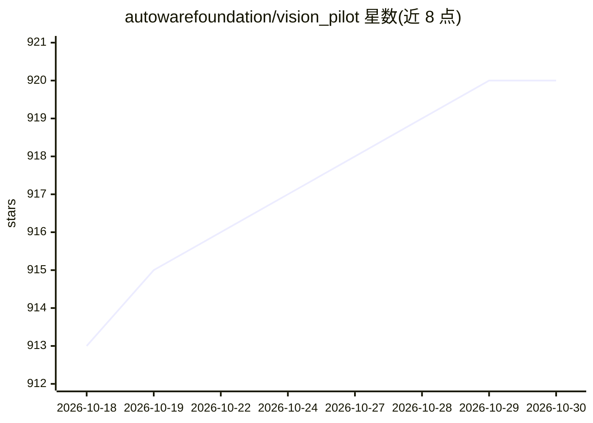

# autowarefoundation/vision_pilot

⭐ 920 · C++ · Apache-2.0 · 推送 2026-10-19 · [GitHub](https://github.com/autowarefoundation/vision_pilot) · [官网](https://autoware.org/) · 组织维护

**面向量产乘用车的开源 L2 ADAS 全栈（端到端 AI）**

Autoware Foundation 维护的 L2 级高级驾驶辅助系统完整代码库，含 AI 模型权重，Apache 2.0 许可。提供 ACC、FCW、AEB、LKAS、LDW、ISA 与单车道高速公路 Autopilot 功能。核心为混合端到端 AI 架构：感知模型与端到端模型并行处理，由 AutoSpeed/AutoSteer/AutoDrive 三个开源模型组成。仅需单目前视相机（52-55° FOV，1-2MP），无需高精地图。支持源码编译、DEB 预编译包与 Docker 三种安装方式，可在 CARLA 0.9.16 仿真器闭环测试。目标用户为 OEM 与 Tier-1 供应商的量产集成，亦可用于商用车场景。

## 筛选速览

| 维度 | 判定 | 备注 |
|---|---|---|
| AI 角色 | `ai-native` | 本体是模型或模型工具 |
| 许可风险 | `permissive` | Apache-2.0 |
| 部署形态 | `desktop` | 安装包/桌面程序 |
| 模型依赖 | — | README 未给出锁定关系 |
| 硬件要求 | — | 无带数字的原话,不猜 |
| 安装摩擦 | `low` | 无编译、无系统依赖或容器化 |
| 成熟度 | — | 结构信号不足 |

## 能力要点

- ACC/FCW/AEB/LKAS/LDW/ISA/单车道 Autopilot 共 7 项 L2 功能
- 混合端到端 AI 架构：AutoSpeed/AutoSteer/AutoDrive 三个开源模型
- 单目摄像头即可运行，无需高精地图（mapless 模式）
- 开放 AI 模型权重，Apache 2.0 许可可商用

## 适用场景

- OEM/Tier-1 在量产乘用车中集成 L2 ADAS 功能
- 在 CARLA 仿真器中闭环测试 ADAS 系统
- 基于公开数据集（OpenLane）开环评估感知输出

## 场景标签

 · 领域:自动驾驶/汽车软件

## 证据(README 行号)

> L23: **This codebase contains a productionizable and safety certifiable implementation of an open-source L2 ADAS system
> L51: We utilize a **Hybrid End-to-End AI Architecture** as the core of Vision Pilot in which data is processed in parall
> L56: 1. AutoSpeed - Closest in-path object detection

## 星数曲线

2026-10-18 913 → 2026-10-30 920（+7）

---
*卡片 v1 · prompt 1.4 · 生成 2026-10-21 · 置信度 high · 依据 README sha `0dfabbdbb742` · [字段定义](../../DATASET.md)*
