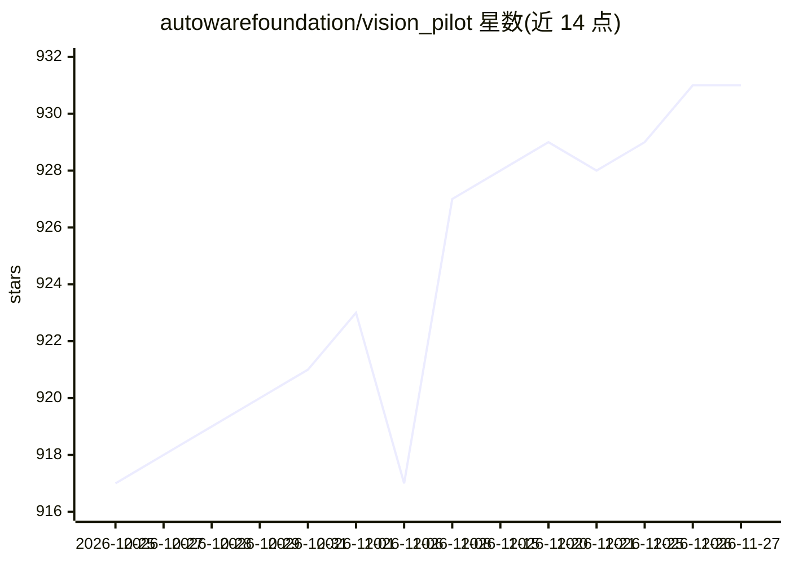

# autowarefoundation/vision_pilot

⭐ 931 · C++ · Apache-2.0 · 推送 2026-11-26 · [GitHub](https://github.com/autowarefoundation/vision_pilot) · [官网](https://autoware.org/) · 组织维护

**面向车企与开发者的开源 L2 级端到端 AI 辅助驾驶栈**

由 Autoware Foundation 提供的开源 L2 ADAS 软件栈，包含 ACC、FCW、AEB、LKAS、LDW、ISA 与单车道高速公路 Autopilot 等功能实现。核心采用混合端到端 AI 架构，并行运行感知模型与端到端模型，内置 AutoSpeed、AutoSteer、AutoDrive 三个开源模型及权重，无需高精地图即可实时循线行驶。以 C++/CMake 构建，支持 CPU 或 NVIDIA GPU（CUDA/TensorRT）推理，可选 ROS 2 接口，提供源码构建、预编译 DEB 包与 Docker 三种运行方式，Apache 2.0 许可。

## 筛选速览

| 维度 | 判定 | 备注 |
|---|---|---|
| AI 角色 | `ai-native` | 本体是模型或模型工具 |
| 许可风险 | `permissive` | Apache-2.0 |
| 部署形态 | `self-host` | docker 或自建部署 |
| 模型依赖 | — | README 未给出锁定关系 |
| 硬件要求 | `cpu-ok` | |
| 安装摩擦 | `low` | 无编译、无系统依赖或容器化 |
| 成熟度 | — | 结构信号不足 |

## 能力要点

- 混合端到端 AI 架构：感知模型与端到端模型并行处理
- 内置 AutoSpeed/AutoSteer/AutoDrive 三个开源模型及权重
- 无高精地图的 mapless 模式实时循线
- 单目前视摄像头（52-55° 水平 FOV、1-2MP）即可运行

## 适用场景

- 为量产乘用车集成入门级 L2 辅助驾驶功能
- 在开放数据视频上做开环场景测试与可视化评估
- 扩展到巴士、卡车等运输物流场景
- 基于 ROS 2 接口做自动驾驶研究与开发

## 场景标签

`目标检测` · 领域:感知与多模态

## 证据(README 行号)

> L51: We utilize a **Hybrid End-to-End AI Architecture** as the core of Vision Pilot in which data is processed in parall
> L56: 1. AutoSpeed - Closest in-path object detection
> L63: **Vision Pilot does not require 3D high definition maps** and operates in a 'mapless' mode to follow the road in

## 星数曲线

2026-10-25 917 → 2026-11-27 931（+14）

---
*卡片 v1 · prompt 1.4 · 生成 2026-11-26 · 置信度 high · 依据 README sha `9dbb8cfb9c8e` · [字段定义](../../DATASET.md)*
