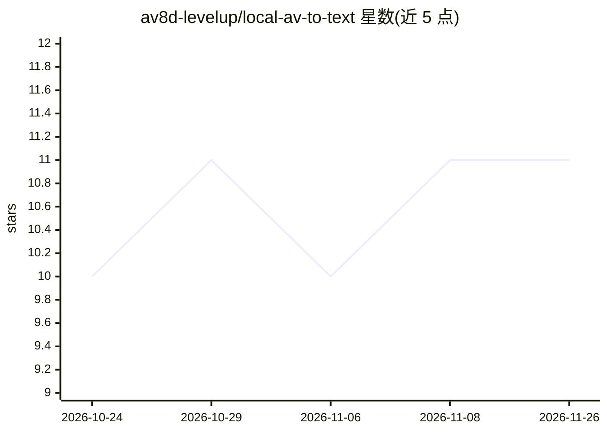

# av8d-levelup/local-av-to-text

⭐ 11 · Python · MIT · 推送 2026-07-26 · [GitHub](https://github.com/av8d-levelup/local-av-to-text) · [官网](https://seo.av8d-levelup.com) · 个人维护 · 中文 README

**本地影音/语音转文字并生成摘要的一键工具**

将 openai-whisper、ffmpeg、yt-dlp、Ollama 等开源工具包装为 Mac/Windows 一键启动的四模式选单：影片转稿配乐、纯语音转稿、整文件夹批处理、本地摘要（Ollama + Gemma 3 生成一句话重点、条列与可发文摘要）。全程在本机运行、不上传，自动偏向繁体中文输出，可搭配 OpenCC 简转繁。本仓库仅提供脚本与启动器，不打包底层工具，需按安装说明一次性装好依赖。

## 筛选速览

| 维度 | 判定 | 备注 |
|---|---|---|
| AI 角色 | `ai-native` | 本体是模型或模型工具 |
| 许可风险 | `permissive` | MIT |
| 部署形态 | `None` |  |
| 模型依赖 | local-ok | 支持本地模型 |
| 硬件要求 | — | 无带数字的原话,不猜 |
| 安装摩擦 | `medium` | 含编译或系统依赖之一 |
| 成熟度 | — | 结构信号不足 |

## 能力要点

- 四个模式：影片转稿＋配乐、纯语音转稿、文件夹批次、摘要
- 摘要经 Ollama 本地生成，支持重点/详细样式并导出 Word (.docx)
- 繁体中文优化，可搭配 OpenCC 简转繁
- 支持 mp3/m4a/wav/aac/flac/ogg/opus 等多种音频格式

## 适用场景

- 把会议录音或课程影片离线转成逐字稿
- 对敏感音视频在本地生成摘要而不上传云端
- 为影片转稿后配上可商用的背景音乐
- 批量处理整个文件夹的音视频文件

## 场景标签

`语音识别` · 领域:感知与多模态

## 证据(README 行号)

> L3: > 一鍵把**影片 / 語音**變成**逐字稿**，還能**配背景音樂**、**產生摘要**。
> L14: - 🎬 **四個模式**：1)影片轉稿＋配樂 / 2)純語音轉稿 / 3)整資料夾批次 / 4)摘要
> L16: - 🧠 **本地摘要**：用 Ollama 產生「一句話重點＋條列＋可發文摘要」，一樣不外流

## 星数曲线

2026-10-24 10 → 2026-11-26 11（+1）

---
*卡片 v1 · prompt 1.4 · 生成 2026-11-18 · 置信度 high · 依据 README sha `a343af5d3e2a` · [字段定义](../../DATASET.md)*
