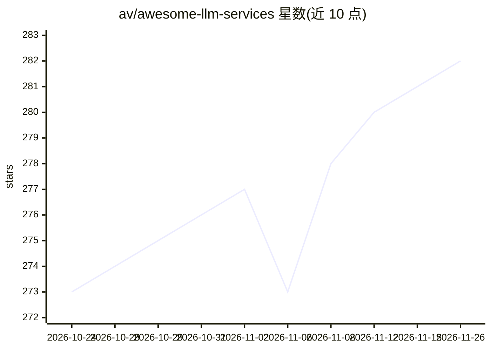

# av/awesome-llm-services

⭐ 282 · TypeScript · MIT · 推送 2026-11-25 · [GitHub](https://github.com/av/awesome-llm-services) · 个人维护

**面向本地自托管 AI 场景的开源 LLM 服务清单（155+ 条）**

收录 155+ 个可自托管的开源 LLM 服务与工具，收录标准包括开源、可自托管、容器友好（Docker/Podman）、面向 homelab/个人 AI 场景且文档完备。条目按前端、后端等类别组织，附相关度评分（由星标流行度与 90 天半衰期的时效衰减合成的复合指标）。定期维护审查，移除已归档或长期无提交的项目，记录各项目仓库地址、许可与自托管指引。关联 harbor 仓库并维护 Discord。

## 筛选速览

| 维度 | 判定 | 备注 |
|---|---|---|
| AI 角色 | `ai-knowledge` | 知识聚合/清单类 |
| 许可风险 | `permissive` | MIT |
| 部署形态 | `None` |  |
| 模型依赖 | — | README 未给出锁定关系 |
| 硬件要求 | — | 无带数字的原话,不猜 |
| 安装摩擦 | `medium` | 含编译或系统依赖之一 |
| 成熟度 | — | 结构信号不足 |

## 能力要点

- 155+ 条开源可自托管 LLM 服务，按前端/后端等类别组织
- 相关度评分综合星标流行度与时效衰减（90 天半衰期）
- 定期维护审查：检查许可、自托管说明并移除归档项目
- 收录标准要求容器友好与文档完备

## 适用场景

- 为 homelab 或个人本地运行 AI 挑选自托管服务
- 查找支持 Docker/Podman 部署的 LLM 前端与推理后端
- 了解各开源 LLM 项目的活跃度与维护状态

## 场景标签

`精选清单` · 领域:学习与行业

## 证据(README 行号)

> L9: A list of **155+** LLM services, tools, and infrastructure for running AI locally. Criteria for inclusion:
> L16: Relevance score ( 0–100%): a composite metric of **Popularity** (logarithm of stars) and **Recency** (exponential d
> L22: ## Contents

## 星数曲线

2026-10-24 273 → 2026-11-26 282（+9）

---
*卡片 v1 · prompt 1.4 · 生成 2026-11-26 · 置信度 high · 依据 README sha `efe563343675` · [字段定义](../../DATASET.md)*
