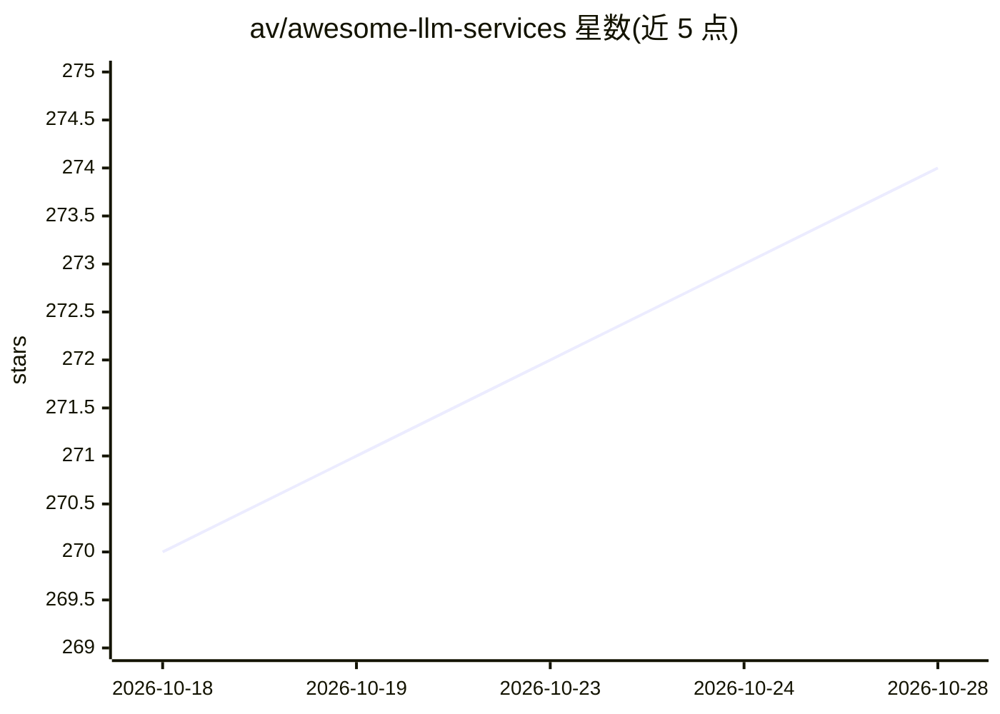

# av/awesome-llm-services

⭐ 275 · TypeScript · MIT · 推送 2026-10-28 · [GitHub](https://github.com/av/awesome-llm-services) · 个人维护

**自托管 LLM 服务精选清单：161+ 个可本地运行的 AI 工具**

由 av 维护的 awesome 类清单，收录 161+ 个开源、可自托管、对容器化友好的 LLM 服务与基础设施项目，面向 homelab 和个人 AI 使用场景。条目按 Frontends、Backends 等类别组织，每个条目附 stars、issue 数、更新日期与相关度评分；评分由流行度（stars 对数）与近效性（90 天半衰期指数衰减）复合计算，用于反映项目的受认可度与维护活跃度。清单关联同一维护者的 av/harbor 仓库。

## 筛选速览

| 维度 | 判定 | 备注 |
|---|---|---|
| AI 角色 | `ai-knowledge` | 知识聚合/清单类 |
| 许可风险 | `permissive` | MIT |
| 部署形态 | `None` |  |
| 模型依赖 | — | README 未给出锁定关系 |
| 硬件要求 | — | 无带数字的原话,不猜 |
| 安装摩擦 | `medium` | 含编译或系统依赖之一 |
| 成熟度 | — | 结构信号不足 |

## 能力要点

- 收录 161+ 个开源、可自托管、容器化友好的 LLM 服务与基础设施
- 按 Frontends / Backends 等类别组织条目
- 每条附 stars、issue 统计、更新日期与 0–100% 相关度评分
- 相关度评分结合流行度（stars 对数）与近效性（90 天半衰期衰减）

## 适用场景

- 为 homelab 或个人 AI 部署挑选本地 LLM 前端与推理后端
- 按活跃度评分发现近期仍在维护的自托管 AI 项目
- 了解本地 AI 生态中前端、后端、工具的分布

## 场景标签

`精选清单` · 领域:学习与行业

## 证据(README 行号)

> L9: A list of **161+** LLM services, tools, and infrastructure for running AI locally. Criteria for inclusion:
> L13: - Relates to homelab or personal AI use cases
> L16: Relevance score ( 0–100%): a composite metric of **Popularity** (logarithm of stars) and **Recency** (exponential d

## 星数曲线

2026-10-18 270 → 2026-10-28 274（+4）

---
*卡片 v1 · prompt 1.4 · 生成 2026-10-22 · 置信度 high · 依据 README sha `0671182f2603` · [字段定义](../../DATASET.md)*
