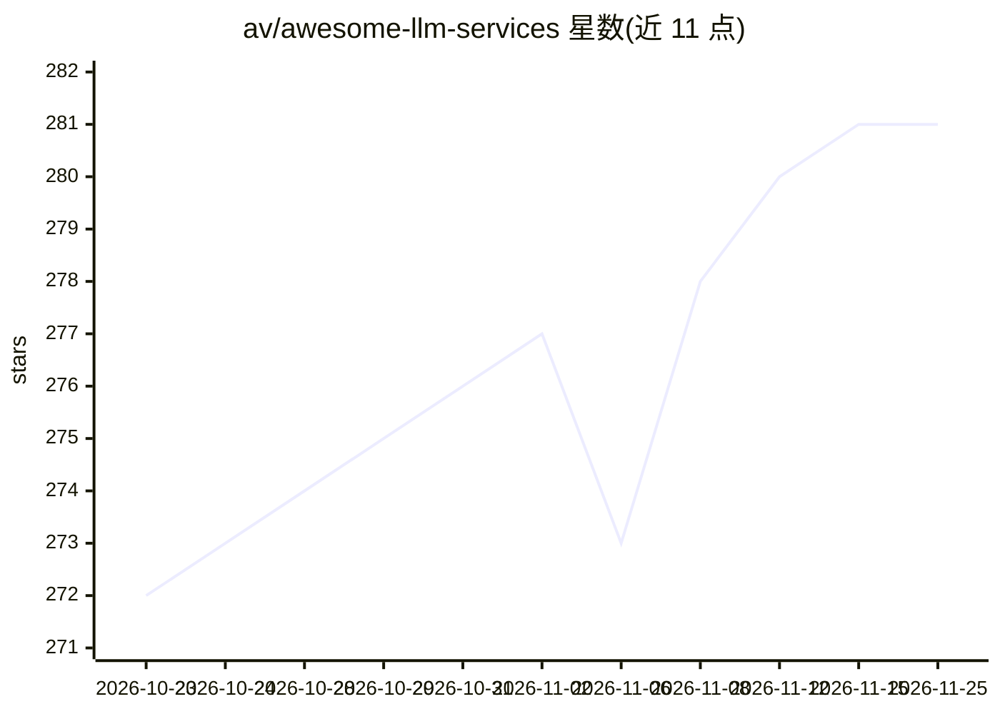

# av/awesome-llm-services

⭐ 281 · TypeScript · MIT · 推送 2026-11-21 · [GitHub](https://github.com/av/awesome-llm-services) · 个人维护

**面向自托管用户的本地 LLM 服务与工具清单（155+ 条）**

收录 155+ 个可自托管的 LLM 服务、工具与基础设施的开源清单，按收录标准（开源、可自托管、容器化友好、面向 homelab/个人 AI 场景、文档完善）筛选，条目按 Frontends、Backends 等类别组织，每条标注相关度评分（由 stars 对数与 90 天半衰期新近度合成的复合指标）、维护审查日期与分类标签，并链接上游仓库、发布与许可证信息。清单本身不提供安装命令，定期移除归档或停更项目。

## 筛选速览

| 维度 | 判定 | 备注 |
|---|---|---|
| AI 角色 | `ai-knowledge` | 知识聚合/清单类 |
| 许可风险 | `permissive` | MIT |
| 部署形态 | `None` |  |
| 模型依赖 | — | README 未给出锁定关系 |
| 硬件要求 | — | 无带数字的原话,不猜 |
| 安装摩擦 | `medium` | 含编译或系统依赖之一 |
| 成熟度 | — | 结构信号不足 |

## 能力要点

- 155+ 条自托管 LLM 服务条目，按 Frontends/Backends 等分类组织
- 每条附相关度评分（Popularity + Recency 复合指标）与分类标签
- 定期维护审查：检查链接、许可证、上游活动并移除停更项目
- 收录标准：开源、可自托管、容器化友好、面向 homelab/个人 AI

## 适用场景

- 为本地/homelab 搭建挑选自托管 LLM 前端与推理后端
- 了解某个类目下有哪些开源可自托管项目及其活跃度
- 按容器化友好标准筛选可 Docker 部署的 AI 服务

## 场景标签

`精选清单` · 领域:学习与行业

## 证据(README 行号)

> L9: A list of **155+** LLM services, tools, and infrastructure for running AI locally. Criteria for inclusion:
> L13: - Relates to homelab or personal AI use cases

## 星数曲线

2026-10-23 272 → 2026-11-25 281（+9）

---
*卡片 v1 · prompt 1.4 · 生成 2026-11-25 · 置信度 high · 依据 README sha `3989d7146359` · [字段定义](../../DATASET.md)*
