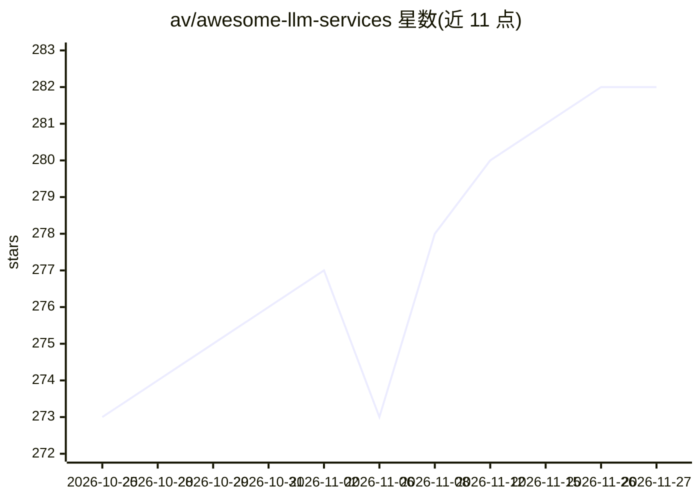

# av/awesome-llm-services

⭐ 282 · TypeScript · MIT · 推送 2026-11-26 · [GitHub](https://github.com/av/awesome-llm-services) · 个人维护

**可自托管的 LLM 服务与工具清单（155+ 条目）**

面向本地运行 AI 的用户维护的清单，收录 155+ 个开源、可自托管、对容器化友好的 LLM 服务、工具与基础设施，按 Frontends、Backends 等章节组织。每个条目附 GitHub 仓库链接、许可证、Star 数、issue 统计与最近更新日期，并给出 0–100% 相关度评分（由 Star 数与 90 天半衰期的时效衰减合成）。清单定期维护审查，移除已归档或一年以上无提交的项目。收录标准包括开源、可自托管、文档完善、面向 homelab/个人 AI 场景。

## 筛选速览

| 维度 | 判定 | 备注 |
|---|---|---|
| AI 角色 | `ai-knowledge` | 知识聚合/清单类 |
| 许可风险 | `permissive` | MIT |
| 部署形态 | `None` |  |
| 模型依赖 | — | README 未给出锁定关系 |
| 硬件要求 | — | 无带数字的原话,不猜 |
| 安装摩擦 | `medium` | 含编译或系统依赖之一 |
| 成熟度 | — | 结构信号不足 |

## 能力要点

- 收录 155+ 个可自托管 LLM 服务，含条目链接、许可证与活跃度指标
- 0–100% 相关度评分：Star 对数与 90 天半衰期时效衰减的复合指标
- 定期维护审查，移除归档与一年以上无提交的项目
- 收录标准：开源、自托管、容器化友好、文档完善

## 适用场景

- 为 homelab 挑选可自托管的 LLM 前端与推理后端
- 按活跃度和维护状态筛选本地 AI 项目
- 了解本地 LLM 生态中前端/后端/工具的分类版图

## 场景标签

`精选清单` · 领域:学习与行业

## 证据(README 行号)

> L9: A list of **155+** LLM services, tools, and infrastructure for running AI locally. Criteria for inclusion:
> L16: Relevance score ( 0–100%): a composite metric of **Popularity** (logarithm of stars) and **Recency** (exponential d
> L18: Last maintenance review: **2026-11-11**. Project links, licensing, self-hosting instructions for new submissions, a

## 星数曲线

2026-10-25 273 → 2026-11-27 282（+9）

---
*卡片 v1 · prompt 1.4 · 生成 2026-11-27 · 置信度 high · 依据 README sha `1a51c1257d28` · [字段定义](../../DATASET.md)*
