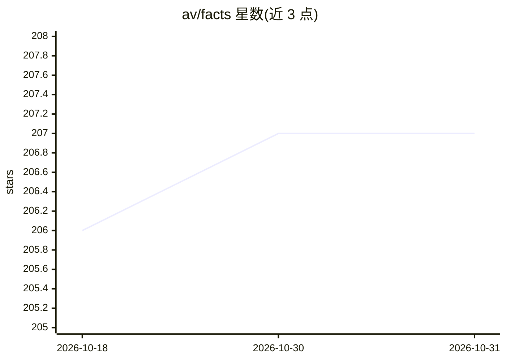

# av/facts

⭐ 207 · Rust · 推送 2026-06-03 · [GitHub](https://github.com/av/facts) · 个人维护

**面向 AI agent 的项目事实清单工具：原子声明+命令验证**

以 `.facts` 文件（合法 Markdown/YAML）记录项目的原子事实声明，每条事实用 @draft→@spec→@implemented 标签跟踪生命周期；绑定 shell 命令的事实由 `facts check` 执行命令验证（退出 0 即通过），可接入 CI 或由 agent 在变更后自检。随附四个 agent 技能（发现/精炼/实现/核心操作），让 Claude、Codex 等 agent 读写事实表并自行验证实现。单个 Rust 二进制，支持 Linux/macOS/Windows，提供 npm/pipx/curl 等多种安装方式。

## 筛选速览

| 维度 | 判定 | 备注 |
|---|---|---|
| AI 角色 | `ai-ecosystem` | LLM/agent 周边工具 |
| 许可风险 | `none` | — |
| 部署形态 | `library` | 以包/库形式分发 |
| 模型依赖 | — | README 未给出锁定关系 |
| 硬件要求 | — | 无带数字的原话,不猜 |
| 安装摩擦 | `low` | 无编译、无系统依赖或容器化 |
| 成熟度 | — | 结构信号不足 |

## 能力要点

- `.facts` 格式同时合法于 Markdown 与 YAML，每行一条原子声明
- `facts check` 运行命令型事实做机器验证，可用 `--agent` 对接 claude/codex 等预设
- 四个内置 agent 技能管理 @draft→@spec→@implemented 全生命周期
- 单个 Rust 二进制，两个依赖，跨 Linux/macOS/Windows

## 适用场景

- 让 AI 编程 agent 依据可机器验证的规格实施与自检
- 在 CI 中用一条命令核验项目声明的实现状态
- 以短清单形式向 agent 传达项目当前事实，替代冗长规格文档

## 场景标签

 · 领域:开发者工具/规格驱动开发

## 证据(README 行号)

> L19: That's a `.facts` file, where each line is one atomic claim about your project. Tags track where each fact is in it
> L55: Four skills ship with every install. Your agent uses them to manage the full lifecycle without you directing every 
> L80: **Verify** your facts with `facts check`, which lints all files and runs every command-fact. Manual facts stay as `

## 星数曲线

2026-10-18 206 → 2026-10-31 207（+1）

---
*卡片 v1 · prompt 1.4 · 生成 2026-10-22 · 置信度 high · 依据 README sha `80fa39197007` · [字段定义](../../DATASET.md)*
