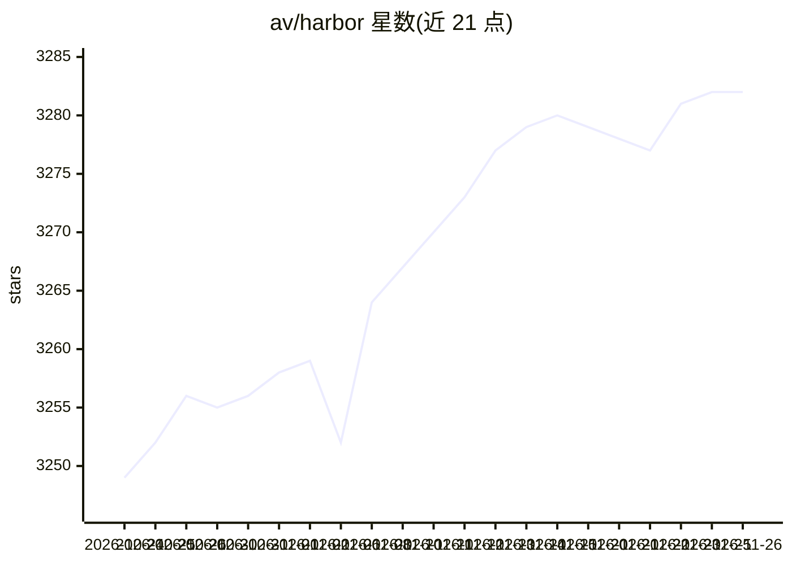

# av/harbor

⭐ 3,282 · Python · Apache-2.0 · 推送 2026-11-11 · [GitHub](https://github.com/av/harbor) · [官网](https://discord.gg/8nDRphrhSF) · 个人维护

**一条命令拉起本地 LLM 全栈的 CLI 与配套应用**

Harbor 提供 CLI 与配套桌面应用，通过 `harbor up` 以 Docker Compose 编排启动本地 LLM 栈：推理后端（Ollama、llama.cpp、vLLM 等）、前端（Open WebUI 等）及搜索、语音、图像生成等配套服务，并自动完成跨服务接线。另含 MCP 管理、配置 profile、命令历史、隧道暴露与 eject 导出 docker-compose 功能。作者定位为本地开发环境的助手工具，非部署方案；服务运行依赖 Docker。

## 筛选速览

| 维度 | 判定 | 备注 |
|---|---|---|
| AI 角色 | `ai-ecosystem` | LLM/agent 周边工具 |
| 许可风险 | `permissive` | Apache-2.0 |
| 部署形态 | `self-host` | docker 或自建部署 |
| 模型依赖 | local-ok | 支持本地模型 |
| 硬件要求 | — | 无带数字的原话,不猜 |
| 安装摩擦 | `low` | 无编译、无系统依赖或容器化 |
| 成熟度 | — | 结构信号不足 |

## 能力要点

- 单命令启动预连线的本地 LLM 栈（harbor up ollama/searxng 等）
- 支持多种推理引擎与 macOS Metal / Linux GPU 宿主推理（dmr/mlx/omlx）
- harbor launch 将 OpenAI 兼容后端接入 claude/codex/copilot 等 12 种编码 CLI
- eject 可将当前配置导出为独立 docker-compose 文件

## 适用场景

- 快速在本地搭建带 Web UI 的 LLM 试验环境
- 让本地编码 Agent CLI 使用自托管后端模型
- 一键启动带联网搜索 RAG、语音对话或图像生成的聊天栈

## 场景标签

`图像生成` `RAG` `推理引擎` · 领域:内容生成

## 证据(README 行号)

> L28: Harbor is a CLI and companion app that lets you spin up a complete local LLM stack—backends like Ollama, llama.cpp,
> L292: - Harbor is not designed as a deployment solution, but rather as a helper for the local LLM development environmen

## 星数曲线

2026-10-24 3,249 → 2026-11-26 3,282（+33）

---
*卡片 v1 · prompt 1.4 · 生成 2026-11-23 · 置信度 mid · 依据 README sha `ae2e2b9b049f` · [字段定义](../../DATASET.md)*
