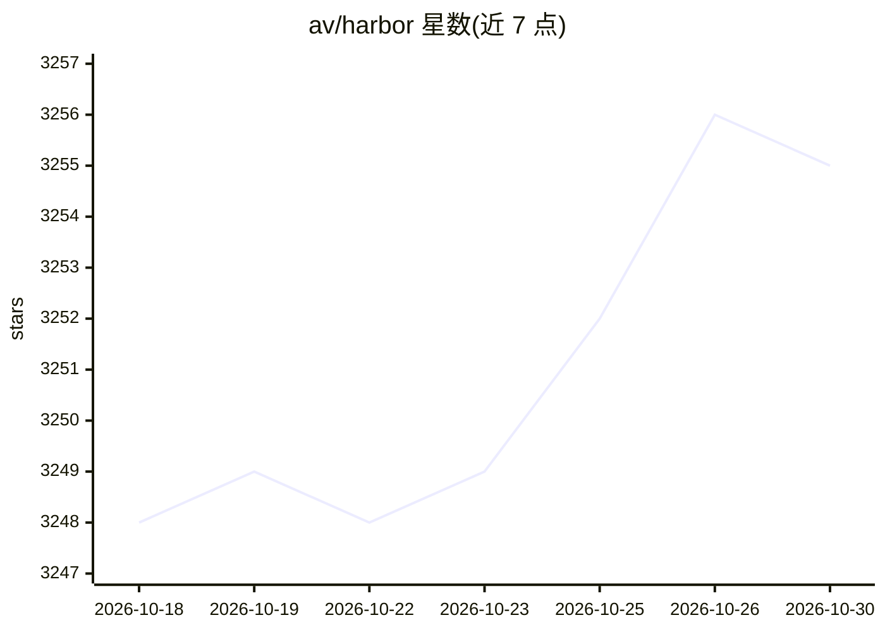

# av/harbor

⭐ 3,255 · Python · Apache-2.0 · 推送 2026-10-24 · [GitHub](https://github.com/av/harbor) · [官网](https://discord.gg/8nDRphrhSF) · 个人维护

**本地 LLM 全栈编排 CLI：一条命令拉起预接线的推理与配套服务**

Harbor 是一个 CLI 工具与配套桌面应用，通过 Docker Compose 编排本地 LLM 栈：后端（Ollama、llama.cpp、vLLM 等）、前端（Open WebUI 等）及卫星服务（SearXNG 搜索、Speaches 语音、ComfyUI 图像生成、n8n/Dify 工作流、MCP 管理等），服务间预接线开箱互通。支持 harbor launch 将后端接入 coding agent CLI，Boost 模块可编排研究/审计等工作流；提供配置 profile、命令历史、QR 手机访问、隧道暴露与 eject 导出独立 compose 文件。作者自述定位为本地 LLM 开发环境辅助工具，非部署方案。

## 筛选速览

| 维度 | 判定 | 备注 |
|---|---|---|
| AI 角色 | `ai-ecosystem` | LLM/agent 周边工具 |
| 许可风险 | `permissive` | Apache-2.0 |
| 部署形态 | `self-host` | docker 或自建部署 |
| 模型依赖 | local-ok | 支持本地模型 |
| 硬件要求 | — | 无带数字的原话,不猜 |
| 安装摩擦 | `low` | 无编译、无系统依赖或容器化 |
| 成熟度 | — | 结构信号不足 |

## 能力要点

- 单条 harbor up 命令启动预接线的完整本地 LLM 栈
- harbor launch 将 OpenAI 兼容后端接入 claude/codex/copilot 等 12 种 coding CLI
- 目录收录上百个后端与卫星服务（UI、工作流、MCP、RAG 等）
- eject 可将当前配置导出为独立 docker-compose 文件

## 适用场景

- 本地一键搭建 Open WebUI + 推理后端的 LLM 环境
- 让 Codex/Claude Code 等 coding agent 使用本地模型后端
- homelab 中集中管理多个自托管 AI 服务的配置与数据

## 场景标签

`推理引擎` `工作流自动化` · 领域:效率与自动化

## 证据(README 行号)

> L26: Harbor is a CLI and companion app that lets you spin up a complete local LLM stack—backends like Ollama, llama.cpp,
> L290: - Harbor is not designed as a deployment solution, but rather as a helper for the local LLM development environmen

## 星数曲线

2026-10-18 3,248 → 2026-10-30 3,255（+7）

---
*卡片 v1 · prompt 1.4 · 生成 2026-10-21 · 置信度 mid · 依据 README sha `51781791d645` · [字段定义](../../DATASET.md)*
