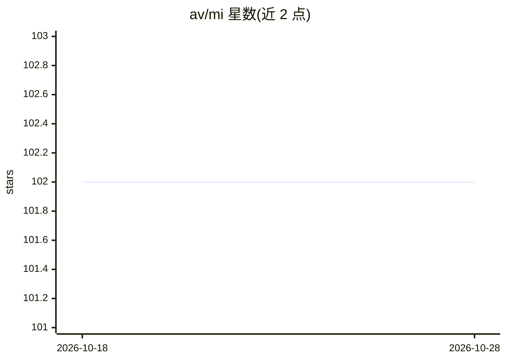

# av/mi

⭐ 102 · JavaScript · 推送 2026-10-11 · [GitHub](https://github.com/av/mi) · 个人维护

**约30行代码的沙箱化 agentic 编码 CLI harness**

面向开发者的命令行 agentic harness：一个循环调用 OpenAI 兼容 API，默认带 bash 与 skill 两个工具，模型自主决定何时调用工具与结束。支持 delegate/goal 生成子代理（plan/work/judge 循环，默认最多 128 次迭代），可通过 self 技能让代理自行编写新工具，向 tools/ 目录放置 .mjs 文件即热加载。提供 --sandbox 模式在 Docker 容器内运行，以及 REPL、非交互 -p 模式与 stdin 管道。以 npx 直接运行。

## 筛选速览

| 维度 | 判定 | 备注 |
|---|---|---|
| AI 角色 | `ai-ecosystem` | LLM/agent 周边工具 |
| 许可风险 | `none` | — |
| 部署形态 | `library` | 以包/库形式分发 |
| 模型依赖 | local-ok | 支持本地模型 |
| 硬件要求 | — | 无带数字的原话,不猜 |
| 安装摩擦 | `low` | 无编译、无系统依赖或容器化 |
| 成熟度 | — | 结构信号不足 |

## 能力要点

- 兼容任意 OpenAI 兼容 API（OpenAI、ollama、lmstudio、litellm、vllm、本地模型）
- delegate/gool 工具原生生成子代理，goal 采用 plan/work/judge 迭代循环
- self 技能与 tools/*.mjs 热加载实现自扩展
- --sandbox 模式在 Docker 容器内运行（PWD 挂载）

## 适用场景

- 在终端用自然语言驱动 bash 执行编码任务
- 通过 goal 工具让子代理迭代完成需评审通过的高层目标
- 在 Docker 沙箱中做破坏性实验
- 以 -p 或 stdin 管道接入脚本与 CI

## 场景标签

`编码 Agent` `Agent 框架` · 领域:Agent 开发

## 证据(README 行号)

> L3: agentic coding in 30 loc. a loop, two tools, and an llm.
> L74: an agentic harness is surprisingly simple. it's a loop that calls an llm, checks if it wants to use tools, executes

## 星数曲线

2026-10-18 102 → 2026-10-28 102（+0）

---
*卡片 v1 · prompt 1.4 · 生成 2026-10-23 · 置信度 high · 依据 README sha `72e227b9c3d0` · [字段定义](../../DATASET.md)*
