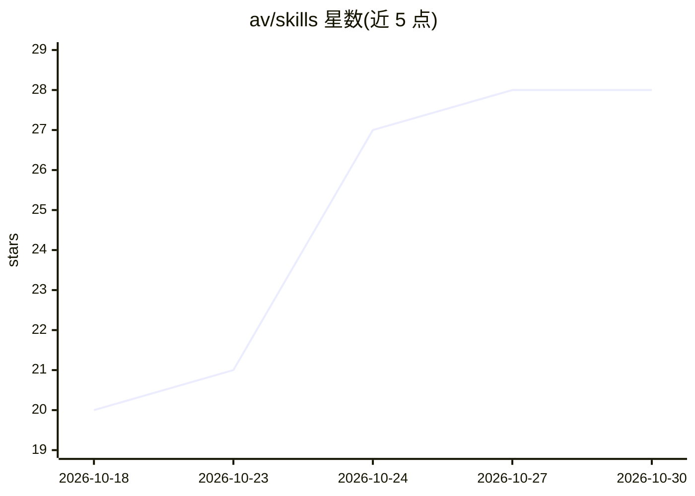

# av/skills

⭐ 28 · Python · MIT · 推送 2026-10-21 · [GitHub](https://github.com/av/skills) · [官网](https://github.com/av/skills) · 个人维护

**面向 Claude Code 等编码 agent 的技能库（26 个 SKILL.md）**

由 @av 维护的 agent 技能集合：26 个以 SKILL.md 形式组织的技能文件夹，覆盖自主编排（子代理工作图、状态机、时限迭代）、代码质量（bug 猎取、AI 代码清理）、写作与研究流水线、本地 LLM 运行（Harbor、llama.cpp 模型拉取）及 agent 操作规程等。技能可直接复制到 .claude/skills/ 或通过 npx skills add 命令安装，供 Claude Code、Codex、OpenCode、Cursor 等编码 agent 使用。

## 筛选速览

| 维度 | 判定 | 备注 |
|---|---|---|
| AI 角色 | `ai-knowledge` | 知识聚合/清单类 |
| 许可风险 | `permissive` | MIT |
| 部署形态 | `library` | 以包/库形式分发 |
| 模型依赖 | — | README 未给出锁定关系 |
| 硬件要求 | — | 无带数字的原话,不猜 |
| 安装摩擦 | `low` | 无编译、无系统依赖或容器化 |
| 成熟度 | — | 结构信号不足 |

## 能力要点

- 26 个技能按编排/代码质量/写作研究/本地 LLM/agent 工艺等类别组织
- 技能为含 SKILL.md 的普通文件夹，可手动复制或 npx 安装
- 支持将本机多个编码 agent 用作编排工作流中的子代理
- 包含 Harbor 本地 LLM 运行与 llamacpp 模型拉取技能

## 适用场景

- 给 Claude Code / Codex / Cursor 等编码 agent 添加自主编排与测试能力
- 通过技能流水线生成长文写作与研究产出
- 使用 Harbor 搭建并运行本地 LLM

## 场景标签

`提示工程` · 领域:Agent 开发

## 证据(README 行号)

> L6: A library of agent skills by @av for **Claude Code**, **Codex**, **OpenCode**, **Cursor** and other coding agents — 
> L18: 26 skills. Install any of them with `npx skills add av/skills --skill <name>`.

## 星数曲线

2026-10-18 20 → 2026-10-30 28（+8）

---
*卡片 v1 · prompt 1.4 · 生成 2026-10-26 · 置信度 high · 依据 README sha `2a70b06c8ac6` · [字段定义](../../DATASET.md)*
