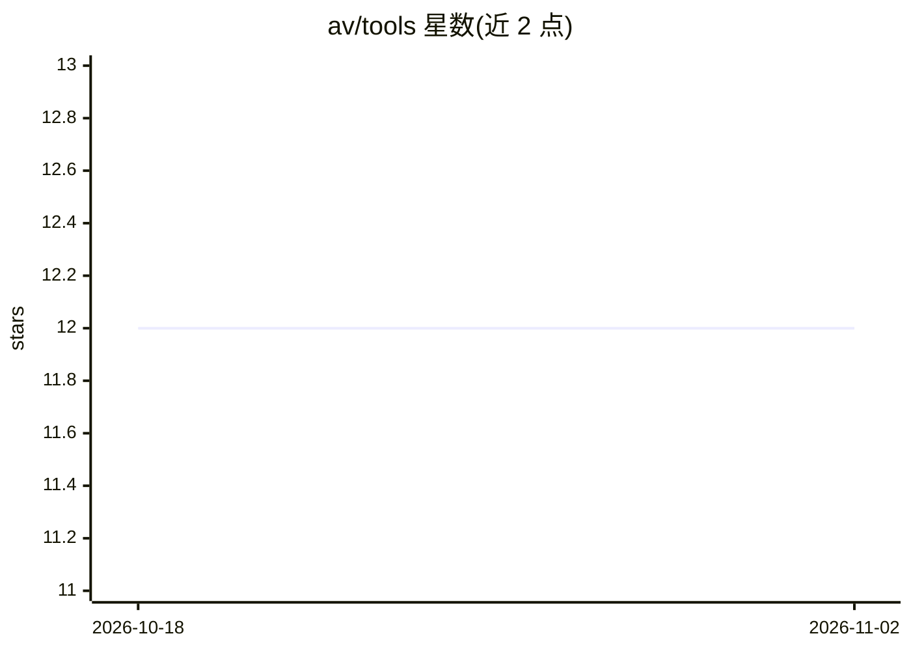

# av/tools

⭐ 12 · Shell · MIT · 推送 2026-05-27 · [GitHub](https://github.com/av/tools) · 个人维护

**供 LLM agent 运行 MCP/OpenAPI/UVX/NPX 工具的 Docker 镜像**

面向 LLM agent 的工具运行容器镜像：内置 Python、Node.js、Deno 运行时与 Rust 工具链，附带 uvx、npx 等包执行器，并预装 mcpo（MCP→OpenAPI 桥接）、supergateway（MCP STDIO/SSE 桥接）与 MCP inspector 调试工具，及 curl/jq/git/ffmpeg 等实用程序。提供基础版与 agentic 变体（后者额外预装文件解析、数据分析、数据访问类 Python 库）。统一缓存于 /app/cache，经 trivy 漏洞扫描。通过 docker run 或 docker compose 启动 MCP 工具。

## 筛选速览

| 维度 | 判定 | 备注 |
|---|---|---|
| AI 角色 | `ai-ecosystem` | LLM/agent 周边工具 |
| 许可风险 | `permissive` | MIT |
| 部署形态 | `self-host` | docker 或自建部署 |
| 模型依赖 | — | README 未给出锁定关系 |
| 硬件要求 | — | 无带数字的原话,不猜 |
| 安装摩擦 | `low` | 无编译、无系统依赖或容器化 |
| 成熟度 | — | 结构信号不足 |

## 能力要点

- 内置 Python/Node.js/Deno 运行时与 Rust 工具链（python/node/uvx/npx/deno/cargo）
- 预装 mcpo、supergateway 与 MCP inspector 用于 MCP/OpenAPI 工具管理与调试
- agentic 变体预装文件处理、数据分析、数据访问类 Python 库
- 统一缓存路径 /app/cache，镜像经 trivy 漏洞扫描

## 适用场景

- 在容器内以 stdio 模式启动 MCP 工具供 agent 调用
- 通过 docker compose 编排多个 MCP 工具服务
- 为 agent 工作流提供预装 Python 库的运行环境

## 场景标签

 · 领域:LLM 基础设施/容器化

## 证据(README 行号)

> L3: Docker image for installing and running tools for LLM agents (MCP, OpenAPI, UVX, NPX, Python)
> L8: - Includes extra packages for managing MCP/OpenAPI tools and connections

## 星数曲线

2026-10-18 12 → 2026-11-02 12（+0）

---
*卡片 v1 · prompt 1.4 · 生成 2026-11-01 · 置信度 high · 依据 README sha `38f6f729a438` · [字段定义](../../DATASET.md)*
