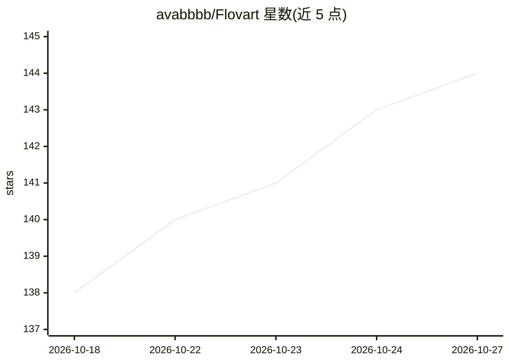

# avabbbb/Flovart

⭐ 144 · TypeScript · MIT · 推送 2026-10-26 · [GitHub](https://github.com/avabbbb/Flovart) · [官网](https://avabbbb.github.io/Flovart/) · 个人维护 · 中文 README

**开源本地优先的可视化创作工作台，人与编码 Agent 共用同一画布**

面向专业剪辑者的创作层产品，首个宿主目标为 DaVinci Resolve Studio 21.1：宿主仍是项目真相源，Flovart 以节点画布（Workflow）承载图像/视频/音频本地编辑（裁剪、修剪、变速、人声分离等，经 ffmpeg.wasm 在浏览器内运行，不调用模型服务），并通过带类型检查的 CLI 操作让外部编码 Agent 在同一可见画布上创建节点、连线与运行，而非屏幕抓取。图像/视频生成采用 BYOK 模式，由用户在设置中添加自有 AI 服务；模型生成与 Resolve 原生集成（Media Pool 回写）在当前版本仍为外部门槛。0.1.0 封闭测试阶段，提供 Windows EXE 与 macOS DMG 预览构建，亦可从源码经 npm 运行 CLI。

## 筛选速览

| 维度 | 判定 | 备注 |
|---|---|---|
| AI 角色 | `ai-enhanced` | 去掉 AI 部分产品仍成立 |
| 许可风险 | `permissive` | MIT |
| 部署形态 | `desktop` | 安装包/桌面程序 |
| 模型依赖 | — | README 未给出锁定关系 |
| 硬件要求 | — | 无带数字的原话,不猜 |
| 安装摩擦 | `medium` | 含编译或系统依赖之一 |
| 成熟度 | `idea` | |

## 能力要点

- Agent 经带类型 CLI 操作（workflow.apply/node.run 等）驱动同一可见画布，含修订与幂等边界
- 图像/视频/音频本地编辑经浏览器内 ffmpeg.wasm 运行，不调用模型服务
- 生成结果以候选（candidate）形式呈现、版本可保留，非破坏式回写宿主
- BYOK：用户自带提供商、模型与 API key；随附 Agent Integration Skill 供 Claude/WorkBuddy 等接入

## 适用场景

- 在 DaVinci Resolve 中对素材帧生成并比对 AI 图层候选，确认后回写 Media Pool
- 让本地编码 Agent 通过自然语言在画布上搭建与执行多步创作工作流
- 在无模型服务的离线环境完成视频裁剪、音频分离等本地媒体处理

## 场景标签

`图像视频处理` `图像生成` · 领域:内容生成

## 证据(README 行号)

> L150: Four local operations on the same generated fixture plate, each producing a real result node. None of them contact
> L205: Not filmed yet, and deliberately not shown: model-backed generation and the model-backed image tools (image genera
> L216: - **Bring your own models.** Keep the providers, models and API keys you choose.

## 星数曲线

2026-10-18 138 → 2026-10-27 144（+6）

---
*卡片 v1 · prompt 1.4 · 生成 2026-10-22 · 置信度 high · 依据 README sha `2d1a206c7497` · [字段定义](../../DATASET.md)*
