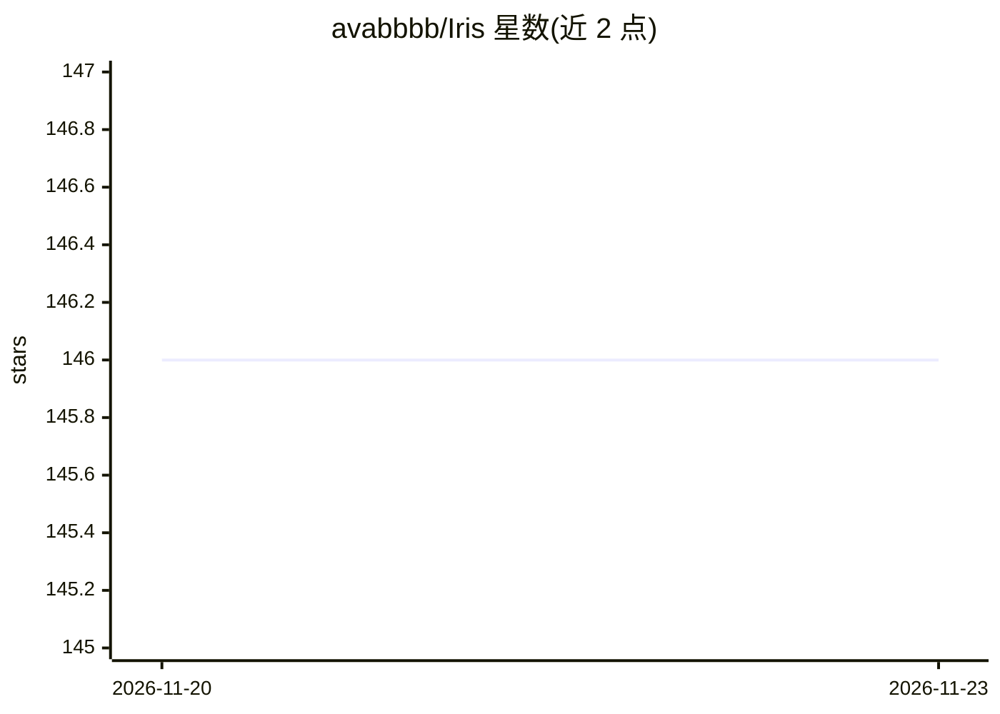

# avabbbb/Iris

⭐ 146 · TypeScript · MIT · 推送 2026-11-22 · [GitHub](https://github.com/avabbbb/Iris) · [官网](https://iris.avabbbb.com) · 个人维护 · 中文 README

**开源无限画布 AgentOS：人与编码代理共同编辑的创意生成工具**

Iris（前身 Flovart）是一个开源、本地优先的创意工作流工具：无限画布上组合图像、视频、文本、音频与配置节点，用户可手动编辑，也可通过 CLI 连接本地编码代理（Codex、Claude Code 等）以类型化操作读写同一工作流。生成结果以候选形式保存，经比较确认后再交付；模型不内置，用户通过 BYOK 配置自己的服务商（如 RunningHub）与 API key。Windows/macOS 提供测试版安装包，也可从源码运行；DaVinci Resolve 等宿主集成仍处实验阶段。

## 筛选速览

| 维度 | 判定 | 备注 |
|---|---|---|
| AI 角色 | `ai-native` | 本体是模型或模型工具 |
| 许可风险 | `permissive` | MIT |
| 部署形态 | `desktop` | 安装包/桌面程序 |
| 模型依赖 | — | README 未给出锁定关系 |
| 硬件要求 | — | 无带数字的原话,不猜 |
| 安装摩擦 | `low` | 无编译、无系统依赖或容器化 |
| 成熟度 | `idea` | |

## 能力要点

- 人类与编码代理编辑同一可见工作流，代理操作通过类型化能力而非屏幕抓取
- 候选先行：生成结果保留全部版本，不会静默覆盖已选结果
- BYOK 多服务商适配，不捆绑模型服务，密钥与费用归用户掌握
- 本地优先存储，素材与生成产物保留在创作者机器附近

## 适用场景

- 在画布上指帧描述意图，生成可审阅的 AI 图层候选
- 让本地编码代理读取项目上下文并执行工作流操作
- 用自己的 API key 配置图像/视频模型进行生成

## 场景标签

`编码 Agent` `图像生成` `视频生成` · 领域:编码与开发

## 证据(README 行号)

> L5:  Iris — open-source AgentOS on an infinite canvas.
> L37: **Keep the original. Describe the change. Compare candidates.** Iris brings your coding Agent and a visible creativ
> L115: |Models|BYOK and multi-provider adapters, with capability-specific status|

## 星数曲线

2026-11-20 146 → 2026-11-23 146（+0）

---
*卡片 v1 · prompt 1.4 · 生成 2026-11-20 · 置信度 mid · 依据 README sha `bfe5e8561608` · [字段定义](../../DATASET.md)*
