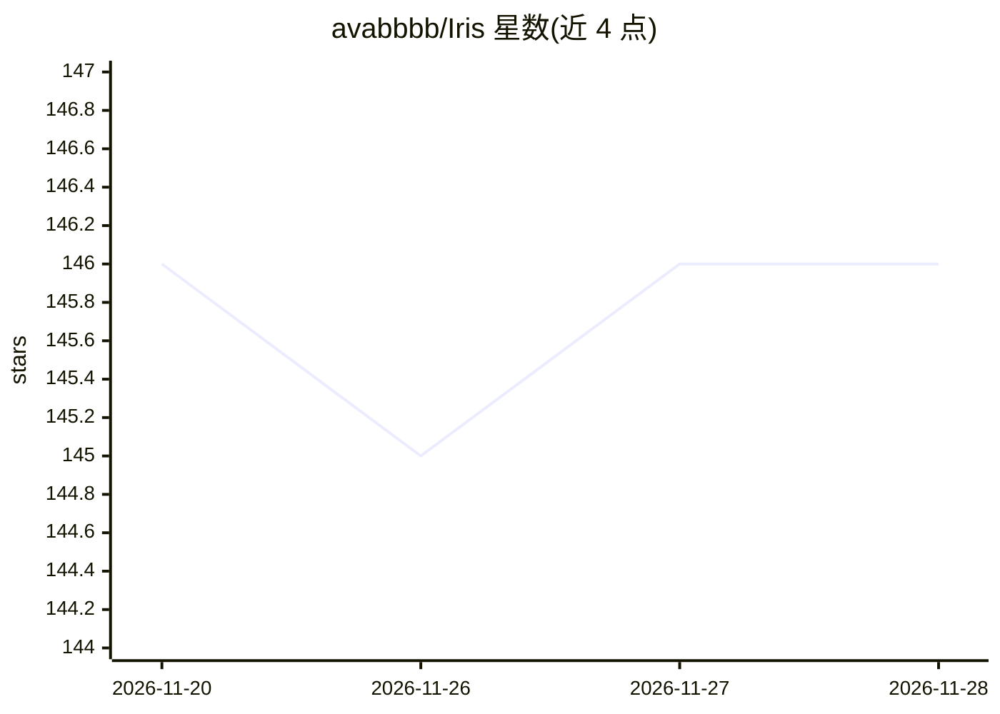

# avabbbb/Iris

⭐ 146 · TypeScript · MIT · 推送 2026-11-27 · [GitHub](https://github.com/avabbbb/Iris) · [官网](https://iris.avabbbb.com) · 个人维护 · 中文 README

**人与 Agent 共同创作的开源无限画布 AIGC 工作台**

AgentOS 定位的创作工作区，由三个模块组成：Canvas 无限画布组织图像/视频/音频/文本节点并按节点调用生成模型，Cut 提供浏览器内多轨视频时间线剪辑（WebCodecs 解码、MP4 导出），Agent 通过 iris_* 工具与审批分级（读/写/exec，含费用与删除硬门控）操作画布。本地优先，项目数据存于浏览器 IndexedDB，API 密钥存加密本地保险库（BYOK）。提供 Web、源码运行、Tauri 桌面包（闭测）三种形态，可通过 CLI/stdio MCP 让 Codex、Claude Code 等外部编码 Agent 接入。多数生成通道与外部 Agent 集成处于 Beta/Experimental 状态。

## 筛选速览

| 维度 | 判定 | 备注 |
|---|---|---|
| AI 角色 | `ai-native` | 本体是模型或模型工具 |
| 许可风险 | `permissive` | MIT |
| 部署形态 | `library` | 以包/库形式分发 |
| 模型依赖 | — | README 未给出锁定关系 |
| 硬件要求 | — | 无带数字的原话,不猜 |
| 安装摩擦 | `low` | 无编译、无系统依赖或容器化 |
| 成熟度 | `idea` | |

## 能力要点

- Canvas/Cut/Agent 三模块：节点式生成、多轨视频剪辑、Agent 工具化操作
- 每次变更携带 projectId+expectedRevision+mutationId，人与 Agent 编辑同一可见状态
- 审批分级与硬门控：付费生成先出成本预估与计划卡，删除需确认，预算原子预留
- 本地优先：数据存浏览器，密钥存加密 localforage，无云同步承诺

## 适用场景

- 在无限画布上串联提示词节点批量生成图像与视频
- 用内置 Agent 代为执行节点生成、剪辑与任务管理
- 让 Codex/Claude Code 等编码 Agent 通过 CLI 驱动同一画布协作
- 离线/本地保存项目数据，自带模型密钥管理生成服务

## 场景标签

`图像生成` `视频生成` · 领域:内容生成

## 证据(README 行号)

> L4:  An open-source AgentOS on an infinite canvas · 人与 Agent 共同创作的无限画布
> L5:  An agent-native creative production workspace: the Canvas organizes assets and generation, Cut edits the video time
> L63: - BYOK: RunningHub image + video is the only provider path in certification (**Beta, pending certification**); Open

## 星数曲线

2026-11-20 146 → 2026-11-28 146（+0）

---
*卡片 v1 · prompt 1.4 · 生成 2026-11-27 · 置信度 high · 依据 README sha `8bdb05565675` · [字段定义](../../DATASET.md)*
