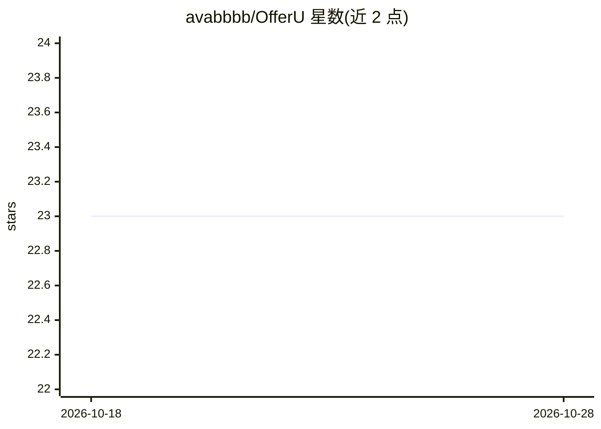

# avabbbb/OfferU

⭐ 23 · Python · MIT · 推送 2026-10-27 · [GitHub](https://github.com/avabbbb/OfferU) · [官网](https://avabbbb.github.io/OfferU/) · 个人维护 · 中文 README

**本地优先的 AI 求职操作系统：岗位研究、简历定制与面试练习**

面向求职者的桌面应用：将每个目标岗位组织为一个持久化的 Job Workspace，聚合岗位快照、角色情报、证据地图、申请材料与面试记录；基于长期职业档案生成简历定制建议（带前后 diff 的接受/拒绝审阅）、针对性面试练习与复盘。AI 部分优先复用用户已有的本地 Agent（Codex/Claude Code 等），无 Agent 时可配置 OpenAI/Anthropic 兼容端点作为回退。技术栈为 React/FastAPI/Tauri，数据存于本地 SQLite；当前处于内部 Beta，仅提供源码开发路径，尚未发布签名安装包。

## 筛选速览

| 维度 | 判定 | 备注 |
|---|---|---|
| AI 角色 | `ai-native` | 本体是模型或模型工具 |
| 许可风险 | `permissive` | MIT |
| 部署形态 | `desktop` | 安装包/桌面程序 |
| 模型依赖 | — | README 未给出锁定关系 |
| 硬件要求 | — | 无带数字的原话,不猜 |
| 安装摩擦 | `low` | 无编译、无系统依赖或容器化 |
| 成熟度 | `idea` | |

## 能力要点

- 每个岗位一个持久化 Workspace，Agent 工作成果沉淀为结构化对象
- AI 简历建议需与职业证据核对，经 diff 审阅后方可写入
- 优先复用本地已有 Agent（Codex/Claude Code 等），API 配置为回退通道
- API 密钥存于 OS keyring，AI 输出不自动成为职业事实

## 适用场景

- 求职者统一管理岗位研究、简历定制与申请进度
- 为每个岗位生成有证据支撑的定制简历
- 基于角色差异与自身证据缺口做针对性面试练习

## 场景标签

`AI 写作` `知识库管理` · 领域:内容生成

## 证据(README 行号)

> L8:  A local-first AI Career OS that compounds what you learn across jobs and interviews.
> L209: If you already use **Codex** with your ChatGPT account, **Claude Code** with your Claude account, or

## 星数曲线

2026-10-18 23 → 2026-10-28 23（+0）

---
*卡片 v1 · prompt 1.4 · 生成 2026-10-27 · 置信度 high · 依据 README sha `b190c64ed9f8` · [字段定义](../../DATASET.md)*
