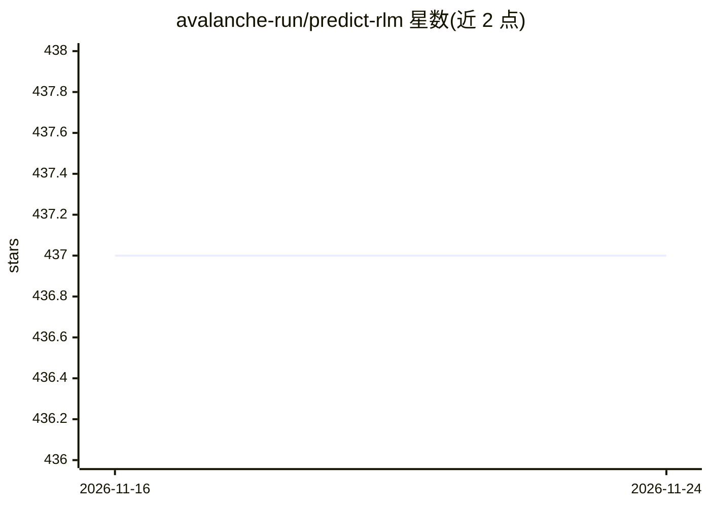

# avalanche-run/predict-rlm

⭐ 437 · Python · MIT · 推送 2026-11-23 · [GitHub](https://github.com/avalanche-run/predict-rlm) · [官网](https://trampoline.ai) · 组织维护

**面向生产的多步 LLM 工作流运行时（RLM）：模型自写代码控制流程**

基于 MIT CSAIL 的 Recursive Language Models 论文实现的 Python 库，由 Trampoline AI 维护。开发者定义输入、输出、工具与操作规程，模型在沙箱化 REPL（默认 WASM/JSPI/Deno/Pyodide，可选 Docker Sandboxes 后端）中编写并执行 Python，自主分支、重试、维护状态，并通过带类型的 DSPy 签名调用子模型，返回结构化输出。每次运行记录代码、工具调用、子调用、计时与 token 用量的完整轨迹，可用于调试与 GEPA 优化。附带文档分析、发票提取等示例，不适合简单对话或一次性分类。

## 筛选速览

| 维度 | 判定 | 备注 |
|---|---|---|
| AI 角色 | `ai-ecosystem` | LLM/agent 周边工具 |
| 许可风险 | `permissive` | MIT |
| 部署形态 | `library` | 以包/库形式分发 |
| 模型依赖 | — | README 未给出锁定关系 |
| 硬件要求 | — | 无带数字的原话,不猜 |
| 安装摩擦 | `low` | 无编译、无系统依赖或容器化 |
| 成熟度 | — | 结构信号不足 |

## 能力要点

- 模型在沙箱 REPL 中编写执行 Python，自主管理控制流与状态
- predict() 以 DSPy/Pydantic 签名发起类型化子模型调用（含多模态）
- 完整可解释轨迹：代码、工具调用、子调用、计时、token、错误
- 文件输入/输出、Workspace 挂载（copy/mount 两种模式）
- 可选 Docker Sandboxes 后端与预热的 SbxPool 并发池

## 适用场景

- 代码库分析与调查、日志证据收集
- 文档审查、PII 脱敏、发票提取、合同比对
- 审计合规与杂乱数据转换，输出带可读轨迹的类型化结果
- 用 GEPA 基于 trace 对 RLM 策略做训练/验证优化

## 场景标签

`Agent 框架` · 领域:Agent 开发

## 证据(README 行号)

> L10: **predict-rlm gives models a runtime for those workflows:** inspect files, keep
> L14: You define the inputs, outputs, tools, and operating procedure. The model writes

## 星数曲线

2026-11-16 437 → 2026-11-24 437（+0）

---
*卡片 v1 · prompt 1.4 · 生成 2026-11-17 · 置信度 mid · 依据 README sha `c93a68056160` · [字段定义](../../DATASET.md)*
