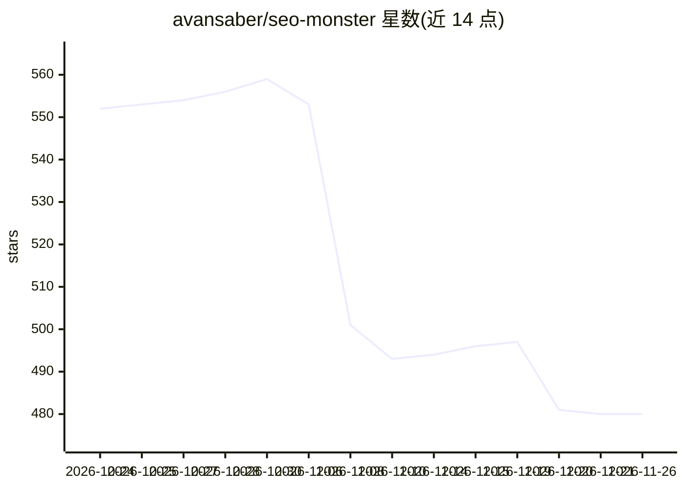

# avansaber/seo-monster

⭐ 480 · Python · MIT · 推送 2026-11-18 · [GitHub](https://github.com/avansaber/seo-monster) · [官网](https://seomonster.avansaber.com/) · 个人维护

**本地运行的 SEO MCP 服务器：让 AI 助手直接操作 GSC/GA4/PageSpeed 数据**

SEOMonster 是一个以用户自身凭证驱动的本地 stdio MCP 服务器，通过 MCP 协议向 Claude、Cursor、Cline、Codex 等 AI 宿主暴露 70 个 SEO 工具，覆盖 Search Console、GA4、PageSpeed Insights、CrUX、Cloudflare、IndexNow/Indexing API、AI 引用追踪等，所有工具返回统一 JSON 结果封套。读操作默认开放，常规写操作（站点地图提交、索引请求）默认开启，Cloudflare 写工具需环境变量门控与逐调用 confirm 令牌。以 PyPI 包发布，也提供 Claude Desktop 的 .mcpb 包；可选的本地 Workbench 伴生组件需从源码安装。

## 筛选速览

| 维度 | 判定 | 备注 |
|---|---|---|
| AI 角色 | `ai-ecosystem` | LLM/agent 周边工具 |
| 许可风险 | `permissive` | MIT |
| 部署形态 | `library` | 以包/库形式分发 |
| 模型依赖 | — | README 未给出锁定关系 |
| 硬件要求 | — | 无带数字的原话,不猜 |
| 安装摩擦 | `low` | 无编译、无系统依赖或容器化 |
| 成熟度 | — | 结构信号不足 |

## 能力要点

- 70 个 MCP 工具统一 JSON 结果封套，另有 13 个命名工作流 prompt
- 用户凭证本地解析，包内零密钥，声明不发送数据给第三方
- 读优先设计：Cloudflare 破坏性写操作需环境变量与 confirm 令牌双重门控
- 支持 uvx 快速启动与 Claude Desktop .mcpb 一键安装两种路径

## 适用场景

- 从自己的 Search Console 数据中发掘接近排名的内容机会
- 发布前让 AI 助手运行技术 SEO 与结构化数据检查
- 追踪品牌在 AI 回答引擎中的声量份额
- 通过代理或多品牌组合批量监控多个站点资产

## 场景标签

 · 领域:SEO/营销数据分析

## 证据(README 行号)

> L118: SEOMonster is a stdio **MCP server**: your AI host launches it, it calls Google / Cloudflare / the AI engines with
> L34: **70 tools** across Search Console, GA4, PageSpeed, Cloudflare, AI-citation tracking, keyword discovery, and techni

## 星数曲线

2026-10-24 552 → 2026-11-26 480（-72）

---
*卡片 v1 · prompt 1.4 · 生成 2026-11-25 · 置信度 high · 依据 README sha `99657794e9b7` · [字段定义](../../DATASET.md)*
