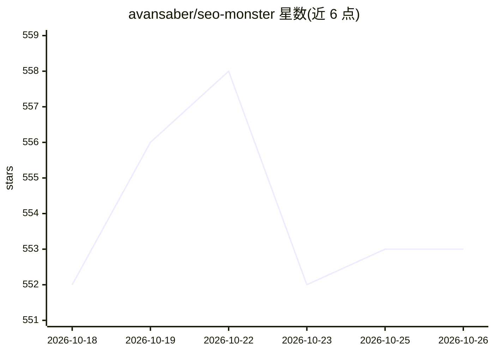

# avansaber/seo-monster

⭐ 553 · Python · MIT · 推送 2026-10-18 · [GitHub](https://github.com/avansaber/seo-monster) · [官网](https://seomonster.avansaber.com/) · 个人维护

**面向 Claude 等 AI 助手的本地 SEO 分析 MCP 服务器（70 工具）**

一个 stdio 协议的 MCP 服务器，把 Google Search Console、GA4、PageSpeed/CrUX、Cloudflare、IndexNow 与 AI 引用追踪等数据源封装为 70 个工具，供 Claude Desktop、Cursor、Cline、Codex 等 AI 客户端以自然语言调用。使用用户自己的凭证在本机运行，读取默认开放，Cloudflare 写操作需环境变量与 per-call confirm 令牌解锁。通过 PyPI 发布，用 uvx 或 .mcpb 一键包安装；部分功能（AI 引用追踪、关键词扩展的可选部分）需 DataForSEO 等付费 API key。

## 筛选速览

| 维度 | 判定 | 备注 |
|---|---|---|
| AI 角色 | `ai-ecosystem` | LLM/agent 周边工具 |
| 许可风险 | `permissive` | MIT |
| 部署形态 | `library` | 以包/库形式分发 |
| 模型依赖 | locked-api |  |
| 硬件要求 | — | 无带数字的原话,不猜 |
| 安装摩擦 | `low` | 无编译、无系统依赖或容器化 |
| 成熟度 | — | 结构信号不足 |

## 能力要点

- 70 个工具覆盖 GSC（18 个）、GA4、PageSpeed、Cloudflare、AI/GEO 引用追踪、关键词发现与技术 SEO
- 统一 JSON 结果封装；读取默认开放，破坏性写操作经 SEO_MCP_ALLOW_DESTRUCTIVE 门控
- 基于用户自有凭证在本地运行，安装包不含任何密钥
- 包含 rank_change_attribution（双重差分+对照组）与 AI 引用 share-of-voice 追踪等分析工具

## 适用场景

- 在 Claude/Cursor 里直接问自然语言问题获取自有网站的 SEO 数据分析
- 发布前运行技术 SEO 与结构化数据检查
- 追踪品牌在各 AI 回答引擎中的引用份额
- 多站点组合的搜索表现汇总与衰退页面诊断

## 场景标签

`数据分析` · 领域:效率与自动化

## 证据(README 行号)

> L63:   H -- "MCP · stdio" --> S["SEOMonster 70 tools"]
> L67: SEOMonster is a stdio **MCP server**: your AI host launches it, it calls Google / Cloudflare / the AI engines with 

## 星数曲线

2026-10-18 552 → 2026-10-26 553（+1）

---
*卡片 v1 · prompt 1.4 · 生成 2026-10-21 · 置信度 high · 依据 README sha `f2b6ae0a24ab` · [字段定义](../../DATASET.md)*
