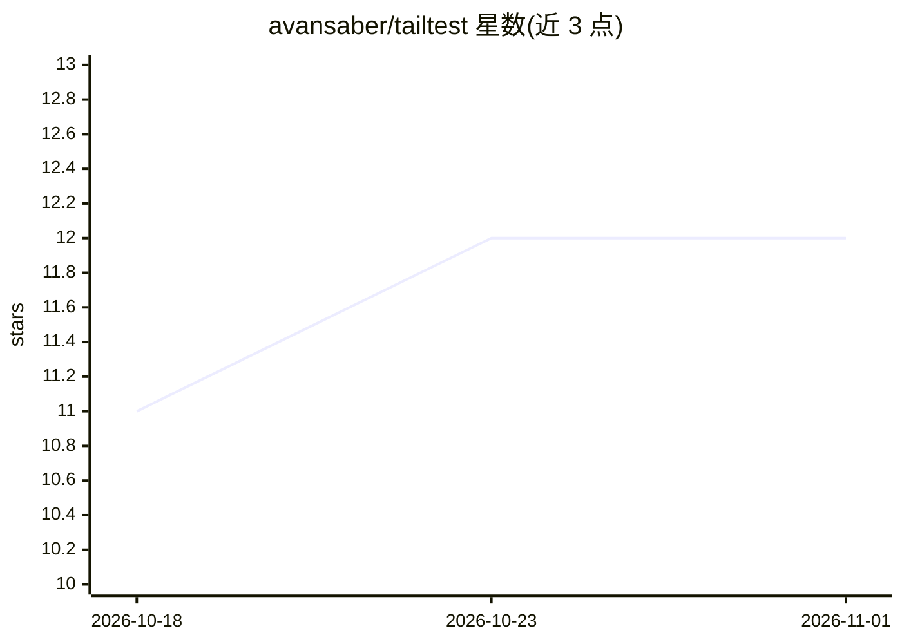

# avansaber/tailtest

⭐ 12 · Python · MIT · 推送 2026-06-14 · [GitHub](https://github.com/avansaber/tailtest) · [官网](https://tailtest.com) · 组织维护

**Claude Code 插件：AI 编辑文件后自动生成并运行测试**

tailtest 是以 MIT 许可开源的 Claude Code 插件，作为 AI 编码过程中的测试层运行：Claude 每次编辑文件后被 hook 队列捕获，基于 R1-R15 规则层生成面向业务行为的测试场景，调用项目已有的测试运行器（pytest、jest、go test 等）执行，并在同一回合内把失败信息返回给 Claude。含对抗模式 R15，偏向 8 类破坏性场景生成，作者称以此在 47 个开源 Python 仓库中发现 16 个真实 bug。通过 claude plugin 命令安装，无遥测、无需 SaaS 账号，另有 Cursor/Codex/Cline 变体仓库。

## 筛选速览

| 维度 | 判定 | 备注 |
|---|---|---|
| AI 角色 | `ai-ecosystem` | LLM/agent 周边工具 |
| 许可风险 | `permissive` | MIT |
| 部署形态 | `None` |  |
| 模型依赖 | locked-api |  |
| 硬件要求 | — | 无带数字的原话,不猜 |
| 安装摩擦 | `low` | 无编译、无系统依赖或容器化 |
| 成熟度 | — | 结构信号不足 |

## 能力要点

- hook 驱动：Claude 编辑文件即自动入队生成测试，无需提示词
- R1-R15 规则层生成业务行为场景，复用已有测试运行器
- 对抗模式 R15 偏向 8 类破坏性场景生成
- 自动从 pyproject.toml/go.mod 等清单检测运行器，支持 10 种语言

## 适用场景

- 让 Claude Code 在编码回路内自动验证每次改动
- 对 AI 代理编辑的文件自动跑回归测试并回传失败
- 用对抗模式发现边界与破坏性输入缺陷

## 场景标签

 · 领域:AI 编码工具/软件测试

## 证据(README 行号)

> L10: **tailtest** is the open-source AI software testing layer for Claude Code. It runs inside the build loop: every tim
> L66: Same R1-R15 rule layer, same adversarial test mode, different host integration. **This repo is the Claude Code vari

## 星数曲线

2026-10-18 11 → 2026-11-01 12（+1）

---
*卡片 v1 · prompt 1.4 · 生成 2026-11-01 · 置信度 high · 依据 README sha `07e52c90f66f` · [字段定义](../../DATASET.md)*
