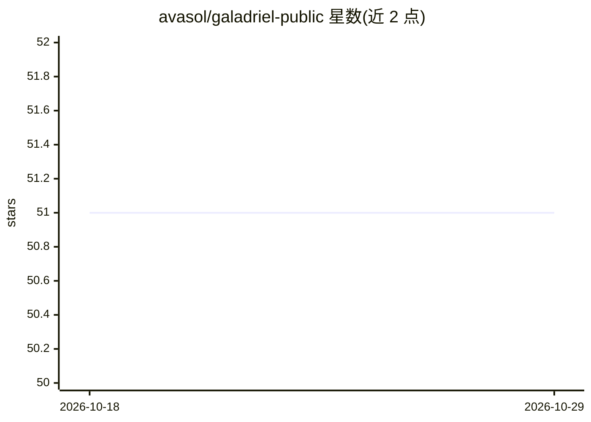

# avasol/galadriel-public

⭐ 51 · Python · MIT · 推送 2026-10-10 · [GitHub](https://github.com/avasol/galadriel-public) · [官网](https://aedelgard.com) · 个人维护

**自托管持久 AI 代理引擎：本地记忆宫 + 可换模型的脑**

运行在自有机器上的持久 AI 代理引擎（Aedelgard 的前身）：通过统一 Provider 适配层接入 Anthropic/Gemini/OpenAI/Bedrock/Nebius(DeepSeek)/Mistral/Berget 等 LLM，可在对话中途换模型而不丢记忆。记忆为本地三层结构（ChromaDB 逐字记录、SQLite 时序知识图谱、Markdown 身份日记），回忆不调用模型。代理可自我修改代码、后台反思、长线程滚动续命。提供 Discord bot、localhost:8080 Web UI、REST API。仓库已冻结为参考引擎，不再合并新特性。威胁模型面向单人自有硬件：run_shell 无限制、Tower 无鉴权。Docker 或本地 Python 运行。

## 筛选速览

| 维度 | 判定 | 备注 |
|---|---|---|
| AI 角色 | `ai-native` | 本体是模型或模型工具 |
| 许可风险 | `permissive` | MIT |
| 部署形态 | `self-host` | docker 或自建部署 |
| 模型依赖 | local-ok | 支持本地模型 |
| 硬件要求 | — | 无带数字的原话,不猜 |
| 安装摩擦 | `low` | 无编译、无系统依赖或容器化 |
| 成熟度 | — | 结构信号不足 |

## 能力要点

- 模型无关的 Provider 适配层，换环境变量即可切换脑而不丢记忆
- 本地记忆宫（ChromaDB+SQLite），回忆零模型调用零 API 花费
- 代理可编辑自身 harness、自我重启并续跑
- 长时运行模块：滚动 rollover、停机存档、本地成本账本

## 适用场景

- 我想在自己机器上跑一个记忆持久、不锁死在单一模型上的 AI 代理
- 让代理通过 Discord 或本地 Web UI 长期陪伴工作
- 研究记忆与模型分离的代理架构并 fork 改造

## 场景标签

`Agent 记忆` `AI 助手` · 领域:Agent 开发

## 证据(README 行号)

> L18: A persistent AI agent harness that runs on your own machine. It connects to any LLM provider (Claude, Gemini, OpenA
> L26: |**🏛️ Memory Palace**|Verbatim semantic search + temporal knowledge graph. Local ChromaDB + SQLite. Recall makes no
> L27: |**🧠 Provider Seam**|One agent, many brains. Swap Claude → Gemini → DeepSeek → local model mid-conversation without

## 星数曲线

2026-10-18 51 → 2026-10-29 51（+0）

---
*卡片 v1 · prompt 1.4 · 生成 2026-10-25 · 置信度 mid · 依据 README sha `5b2af84c5561` · [字段定义](../../DATASET.md)*
