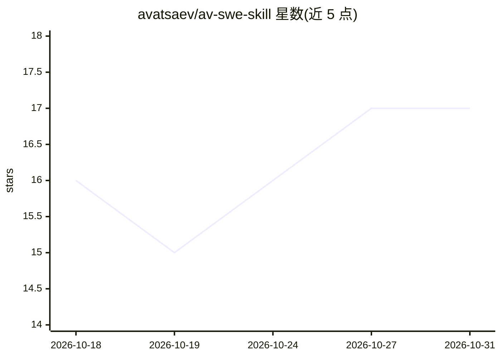

# avatsaev/av-swe-skill

⭐ 17 · MIT · 推送 2026-10-25 · [GitHub](https://github.com/avatsaev/av-swe-skill) · 个人维护

**让编码 Agent 按版本化任务计划执行大规模软件工程的技能**

面向 Claude Code、Cursor、Codex 等 70+ 编码 Agent 的 Agent Skill：把大型软件项目组织为版本化、有序、依赖感知的 sprint/任务计划，以 PLAN.md 为唯一事实源，通过 backlog→in_progress→blocked→done 状态机逐 sprint 执行。提供 grill/scope/plan/implement/status 等 8 个操作；仅 implement 写源代码，且每个任务以项目实际的 build/typecheck/lint/test 命令为通过门槛。产出全部为磁盘上的自描述 markdown，支持跨会话、跨模型的 Agent 交接。通过 npx skills add 或 npm 包 av-swe 安装。

## 筛选速览

| 维度 | 判定 | 备注 |
|---|---|---|
| AI 角色 | `ai-ecosystem` | LLM/agent 周边工具 |
| 许可风险 | `permissive` | MIT |
| 部署形态 | `library` | 以包/库形式分发 |
| 模型依赖 | — | README 未给出锁定关系 |
| 硬件要求 | — | 无带数字的原话,不猜 |
| 安装摩擦 | `low` | 无编译、无系统依赖或容器化 |
| 成熟度 | — | 结构信号不足 |

## 能力要点

- 8 个操作覆盖从需求盘问到 sprint 执行的完整流程
- 任务以项目实际 build/test 命令为完成门槛
- 计划产物为纯 markdown 文件，支持无简报的跨 Agent 交接
- 任务状态由物理文件夹位置表达，git log 即开发历史

## 适用场景

- 让编码 Agent 把大型项目拆成有序 sprint 并逐个执行
- 跨会话/跨模型接力开发时恢复项目完整状态
- 在动手前把模糊想法盘问成有验收标准的规格文档

## 场景标签

`编码 Agent` · 领域:编码与开发

## 证据(README 行号)

> L3: An Agent Skill for managing a large-scale software engineering project
> L24: This uses the official `skills` CLI (the native agent-skills
> L25: package manager, maintained by Vercel), which auto-detects your coding agent (Claude Code, Cursor,

## 星数曲线

2026-10-18 16 → 2026-10-31 17（+1）

---
*卡片 v1 · prompt 1.4 · 生成 2026-10-29 · 置信度 high · 依据 README sha `e7347b41a37d` · [字段定义](../../DATASET.md)*
