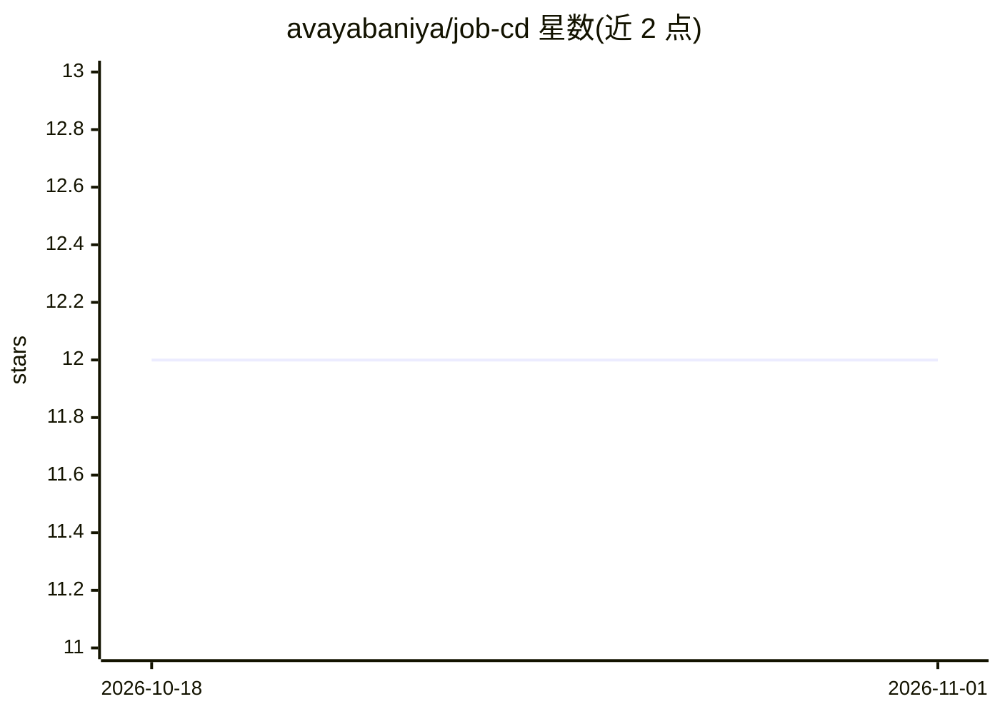

# avayabaniya/job-cd

⭐ 12 · Python · MIT · 推送 2026-09-14 · [GitHub](https://github.com/avayabaniya/job-cd) · 个人维护

**求职外联自动化 CLI：输入职位链接，AI 生成邮件并自动发送**

面向求职者的命令行自动化工具，把求职外联处理为流水线：输入职位 URL，从页面提取公司背景与岗位要求（默认经 Gemini/Antigravity CLI），通过 Apollo.io 查找招聘负责人邮箱，基于本地个人档案生成个性化邮件，并经 SMTP 发送。各环节（提取、发现、撰写、发送）为可替换的接口策略，本地 SQLite 记录投递历史。需自备 AI API key、Apollo key 与 SMTP 凭据。

## 筛选速览

| 维度 | 判定 | 备注 |
|---|---|---|
| AI 角色 | `ai-native` | 本体是模型或模型工具 |
| 许可风险 | `permissive` | MIT |
| 部署形态 | `None` |  |
| 模型依赖 | — | README 未给出锁定关系 |
| 硬件要求 | — | 无带数字的原话,不猜 |
| 安装摩擦 | `low` | 无编译、无系统依赖或容器化 |
| 成熟度 | — | 结构信号不足 |

## 能力要点

- 职位 URL→联系人发现→AI 邮件撰写→SMTP 发送的流水线
- 各组件接口化，默认 AI/发现服务可替换
- 本地 profiles.json 维护人设档案以定制内容
- SQLite 记录每次申请、联系人与邮件状态

## 适用场景

- 批量向目标岗位的招聘负责人发送个性化求职邮件
- 管理多个求职人设档案并保持内容一致
- 追踪求职外联的历史与状态

## 场景标签

 · 领域:职业工具/自动化

## 证据(README 行号)

> L5: `job-cd` is a specialized automation tool focused on the most critical phase of the job search: **personalized email
> L51: - **Hyper-Personalized Content:** Generates tailored, high-conversion cold emails based on your profile and the spe

## 星数曲线

2026-10-18 12 → 2026-11-01 12（+0）

---
*卡片 v1 · prompt 1.4 · 生成 2026-11-01 · 置信度 high · 依据 README sha `a49dca94c552` · [字段定义](../../DATASET.md)*
