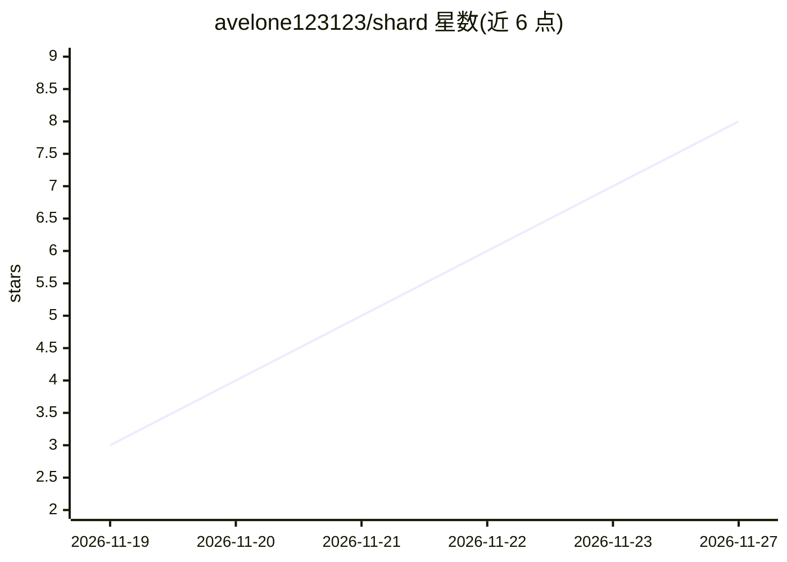

# avelone123123/shard

⭐ 8 · Python · MIT · 推送 2026-11-25 · [GitHub](https://github.com/avelone123123/shard) · [官网](https://avelone123123.github.io/shard/) · 个人维护

**跨机器聚合显存/内存的分布式本地 LLM 推理引擎**

SHARD 是一个开源分布式本地 LLM 推理引擎（Python/FastAPI/PyTorch），通过 UDP 发现与 RPC 把 LAN 内多台机器的 GPU 显存与系统 RAM 汇聚为单一推理集群，支持 GGUF（llama.cpp）与 PyTorch Safetensors 双后端。提供 OpenAI 与 Anthropic 兼容 API 端点、内置 Web 仪表盘、下载前模型显存适配检查（shard fit），以及可选的 C++20/AVX2 SIMD 内核编译。面向在多台家用/办公机器上运行 7B–70B 模型的开发者、实验室与小团队。多机张量分布为实验性功能，建议低延迟有线以太网。

## 筛选速览

| 维度 | 判定 | 备注 |
|---|---|---|
| AI 角色 | `ai-ecosystem` | LLM/agent 周边工具 |
| 许可风险 | `permissive` | MIT |
| 部署形态 | `desktop` | 安装包/桌面程序 |
| 模型依赖 | local-ok | 支持本地模型 |
| 硬件要求 | — | 无带数字的原话,不猜 |
| 安装摩擦 | `low` | 无编译、无系统依赖或容器化 |
| 成熟度 | — | 结构信号不足 |

## 能力要点

- LAN 多机 VRAM/RAM 池化：UDP 自动发现、配对、心跳监控
- OpenAI 与 Anthropic 兼容 API 端点，供 IDE 与 coding agent 接入
- 下载前模型适配检查：返回 GPU/HYBRID/IMPOSSIBLE 判定、上下文长度与量化建议
- 可选 C++20/MASM AVX2 SIMD 原生内核加速

## 适用场景

- 在多台家用/办公电脑上跑单卡装不下的开源大模型
- 为团队自建私有 coding assistant 后端供 IDE 接入
- 下载模型前先检查本机或集群能否装下
- 为 AI agent 流水线提供自托管推理端点

## 场景标签

`推理引擎` · 领域:训练与推理

## 证据(README 行号)

> L47: **SHARD** (`shard-engine`) is an open-source distributed local LLM inference engine written in Python (FastAPI + Py
> L53: SHARD unites idle GPUs and system memory across your Local Area Network (LAN) into a single logical inference clust
> L56: - **Drop-In Agent & IDE Backend:** Expose both OpenAI (`/v1/chat/completions`, `/v1/completions`, `/v1/models`) and

## 星数曲线

2026-11-19 3 → 2026-11-27 8（+5）

---
*卡片 v1 · prompt 1.4 · 生成 2026-11-21 · 置信度 high · 依据 README sha `bfc57f491187` · [字段定义](../../DATASET.md)*
