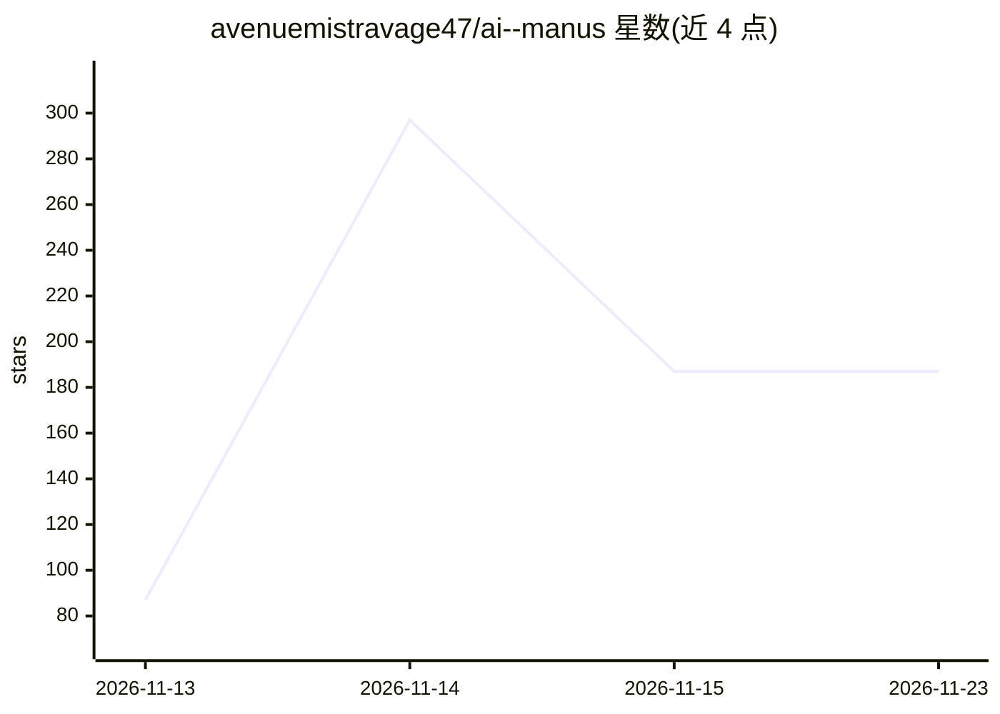

# avenuemistravage47/ai--manus

⭐ 187 · Apache-2.0 · 推送 2026-11-15 · [GitHub](https://github.com/avenuemistravage47/ai--manus) · 个人维护

**面向个人任务的自主 AI Agent：代用户执行代码与浏览器操作**

README 将 Manus 描述为自主 AI Agent，可代用户编写并执行脚本、控制浏览器（导航网页、填写表单、收集信息），完成多步骤任务，定位为家庭、学习与轻量办公场景的个人助手，而非企业平台。仓库描述另称其支持在沙盒环境中运行多种工具与操作。README 以功能介绍和使用建议为主，未提供代码结构、模型接入方式或安装运行命令等可验证细节；给出硬件兼容表（最低 4 GB 内存、双核 CPU）。

## 筛选速览

| 维度 | 判定 | 备注 |
|---|---|---|
| AI 角色 | `ai-native` | 本体是模型或模型工具 |
| 许可风险 | `permissive` | Apache-2.0 |
| 部署形态 | `None` |  |
| 模型依赖 | — | README 未给出锁定关系 |
| 硬件要求 | — | 无带数字的原话,不猜 |
| 安装摩擦 | `low` | 无编译、无系统依赖或容器化 |
| 成熟度 | — | 结构信号不足 |

## 能力要点

- 自主执行代码与控制浏览器完成多步骤任务
- 定位家庭/学习/轻量办公场景的个人助手
- README 提供最低与推荐硬件兼容表

## 适用场景

- 让代理代为执行脚本与网页操作等重复性任务
- 学习与研究中收集资料、整理笔记
- 轻量办公中跨多个网页汇总信息

## 场景标签

`AI 助手` `浏览器自动化` `编码 Agent` · 领域:效率与自动化

## 证据(README 行号)

> L10: - **Autonomous Code Execution:** Manus AI agent runs code on its own to complete tasks, so you can focus on decisio
> L18: Manus is an autonomous AI agent designed to run code and control a browser on your behalf. Instead of acting like a

## 星数曲线

2026-11-13 87 → 2026-11-23 187（+100）

---
*卡片 v1 · prompt 1.4 · 生成 2026-11-17 · 置信度 mid · 依据 README sha `0f78ee3a5dd2` · [字段定义](../../DATASET.md)*
