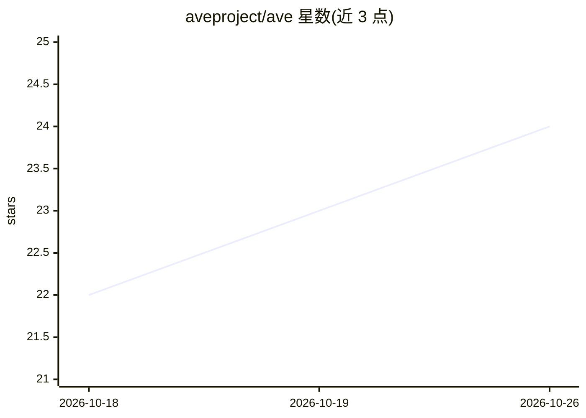

# aveproject/ave

⭐ 24 · Python · Apache-2.0 · 推送 2026-10-24 · [GitHub](https://github.com/aveproject/ave) · [官网](https://aveproject.org/) · 组织维护

**智能体 AI 组件行为漏洞的开放分类标准（87 条记录）**

面向安全团队与工具开发者的命名分类标准：为技能文件、MCP 服务器清单、系统提示词等可被武器化的行为漏洞类分配稳定 ID（AVE-2026-XXXXX），用 OWASP AIVSS v0.8 打分（10 个智能体放大因子、威胁成熟度系数、缓解因子），并映射到 OWASP MCP Top 10、MITRE ATLAS 等既有报告框架。当前收录 87 条记录（1 条 CRITICAL、19 条 HIGH）。README 明确其非运行时强制机制，需独立策略层消费记录；参考实现为 bawbel-scanner。

## 筛选速览

| 维度 | 判定 | 备注 |
|---|---|---|
| AI 角色 | `ai-knowledge` | 知识聚合/清单类 |
| 许可风险 | `permissive` | Apache-2.0 |
| 部署形态 | `library` | 以包/库形式分发 |
| 模型依赖 | — | README 未给出锁定关系 |
| 硬件要求 | — | 无带数字的原话,不猜 |
| 安装摩擦 | `low` | 无编译、无系统依赖或容器化 |
| 成熟度 | — | 结构信号不足 |

## 动量与使用信号

- 下载:GitHub Release 附件 累计 12(2 个 release)

## 能力要点

- 87 条行为漏洞记录，带稳定 ID 与 AIVSS 评分
- 每条记录映射 OWASP MCP Top 10 / MITRE ATLAS / NIST AI RMF
- AIVSS 评分含 10 个智能体放大因子（AARF）与威胁成熟度系数
- 8 个独立第三方工具自发构建了对照映射

## 适用场景

- 安全团队为 agent 技能/MCP 组件漏洞报告统一命名与评分
- 扫描器开发者按标准对齐检出结果的分类标识
- CI 流水线中配合扫描器在部署前阻断恶意技能文件

## 场景标签

`网络安全` · 领域:学习与行业

## 证据(README 行号)

> L41: **AVE fills that gap.** It assigns stable identifiers to distinct behavioral
> L46: AVE is a standard, not a product. The `bawbel-scanner` implements it as the
> L119: |Total records|87|

## 星数曲线

2026-10-18 22 → 2026-10-26 24（+2）

---
*卡片 v1 · prompt 1.4 · 生成 2026-10-18 · 置信度 mid · 依据 README sha `a1b3aed6c35e` · [字段定义](../../DATASET.md)*
