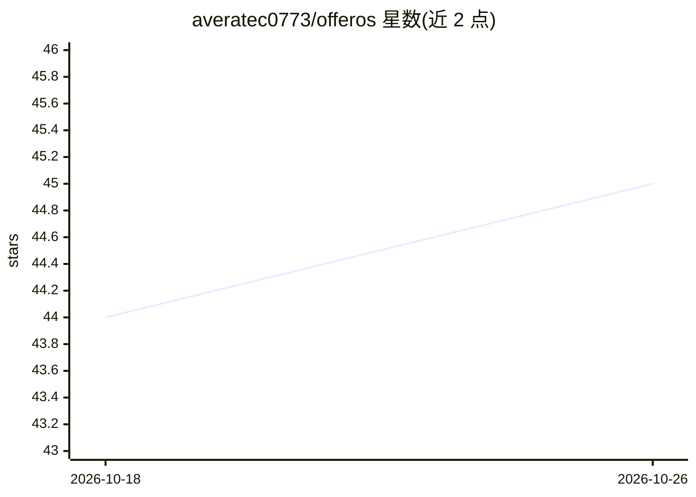

# averatec0773/offeros

⭐ 45 · TypeScript · Apache-2.0 · 推送 2026-10-19 · [GitHub](https://github.com/averatec0773/offeros) · [官网](https://github.com/averatec0773/offeros#readme) · 个人维护

**本地优先的求职申请 AI 代理：跟踪投递状态并代填 ATS 表单**

面向求职者的本地运行应用：Next.js Web 端在本地 SQLite 中管理投递记录、简历与求职信，Chrome 侧边栏扩展在 Greenhouse/Lever/Ashby/iCIMS/Workday 等真实 ATS 表单上执行自动填写，提交按钮始终由用户点击。代理可回答'哪些卡住了、为什么'等问题，其答案要求引用来源并由服务端核验证据。支持自带 Anthropic/OpenAI API key，密钥仅存于服务端。状态为 pre-alpha，需 Node 24+，npm monorepo 源码运行。

## 筛选速览

| 维度 | 判定 | 备注 |
|---|---|---|
| AI 角色 | `ai-native` | 本体是模型或模型工具 |
| 许可风险 | `permissive` | Apache-2.0 |
| 部署形态 | `library` | 以包/库形式分发 |
| 模型依赖 | — | README 未给出锁定关系 |
| 硬件要求 | — | 无带数字的原话,不猜 |
| 安装摩擦 | `low` | 无编译、无系统依赖或容器化 |
| 成熟度 | `idea` | |

## 能力要点

- Chrome 侧边栏扩展代填真实 ATS 表单，逐字段报告填写状态
- 代理答案须引用来源文本并由服务端核验，不可核验的值被丢弃
- 三类问题（自愿自识、工作许可、政策确认）在模型运行前即拒绝代答
- 自带 Anthropic/OpenAI key，数据存于本地单个 SQLite 文件

## 适用场景

- 跟踪我所有求职申请的状态并解释失败原因
- 自动填写各家 ATS 申请表单后由我审核提交
- 发现并一次性补齐反复被问却从未回答的问题

## 场景标签

`浏览器自动化` `AI 助手` · 领域:效率与自动化

## 证据(README 行号)

> L7: Local-first, open-source **AI job-application agent**.
> L14: Everything runs on your machine. `apps/web` (Next.js) owns your data in a local

## 星数曲线

2026-10-18 44 → 2026-10-26 45（+1）

---
*卡片 v1 · prompt 1.4 · 生成 2026-10-25 · 置信度 high · 依据 README sha `937c8140a0af` · [字段定义](../../DATASET.md)*
