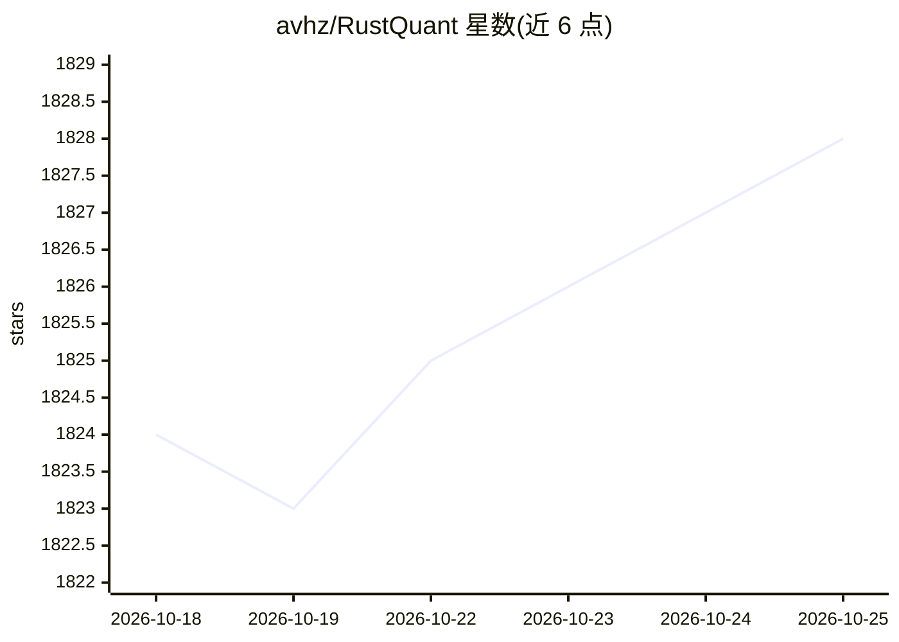

# avhz/RustQuant

⭐ 1,828 · Rust · Apache-2.0 · 推送 2026-10-04 · [GitHub](https://github.com/avhz/RustQuant) · [官网](https://avhz.github.io) · 个人维护

**面向量化金融的 Rust 库：定价、随机过程与数学工具**

用 Rust 编写的量化金融库，模块覆盖金融工具定价（债券、期权）、随机过程生成（布朗运动、CIR/OU/Vasicek 等短利率模型）、自动微分（AAD）、统计分布与数值优化、数据读写（CSV/JSON/Parquet）及 Yahoo! Finance 数据下载、组合与限价订单簿等。ML 模块目前仅实现线性/逻辑回归与 kNN。README 声明为业余项目，不建议用于交易决策。供量化开发者以 cargo 集成使用，附 examples 目录示例。

## 筛选速览

| 维度 | 判定 | 备注 |
|---|---|---|
| AI 角色 | `ai-enhanced` | 去掉 AI 部分产品仍成立 |
| 许可风险 | `permissive` | Apache-2.0 |
| 部署形态 | `library` | 以包/库形式分发 |
| 模型依赖 | — | README 未给出锁定关系 |
| 硬件要求 | — | 无带数字的原话,不猜 |
| 安装摩擦 | `low` | 无编译、无系统依赖或容器化 |
| 成熟度 | `idea` | |

## 能力要点

- AAD 自动微分计算标量函数梯度
- 随机过程生成器与短利率模型（CIR/OU/Vasicek/Hull-White）
- 债券/期权定价与曲线、期限结构数据类型
- 支持 CSV/JSON/Parquet 读写及 Yahoo! Finance 数据下载

## 适用场景

- 在 Rust 项目中为金融工具定价与生成随机路径
- 数值计算场景使用统计分布、FFT 与优化求根
- 拉取 Yahoo! Finance 数据做研究

## 场景标签

`金融量化` · 领域:学习与行业

## 证据(README 行号)

> L21: A Rust library for quantitative finance.
> L40: |`ml`|Currently only linear and logistic regression, along with k-nearest neighbours classification are implemented

## 星数曲线

2026-10-18 1,824 → 2026-10-25 1,828（+4）

---
*卡片 v1 · prompt 1.4 · 生成 2026-10-21 · 置信度 mid · 依据 README sha `5accbeea9166` · [字段定义](../../DATASET.md)*
