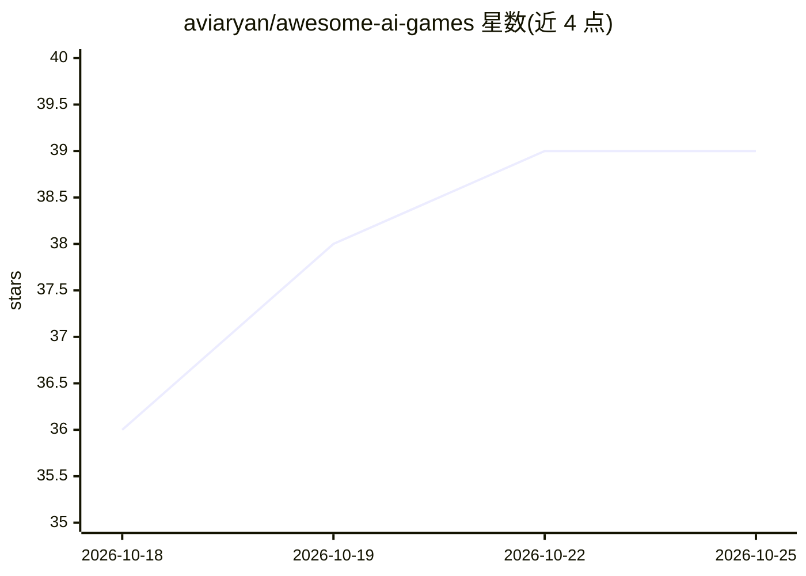

# aviaryan/awesome-ai-games

⭐ 40 · 推送 2026-10-14 · [GitHub](https://github.com/aviaryan/awesome-ai-games) · 个人维护

**AI 制作的浏览器可玩游戏策展清单**

由个人维护的 awesome 类清单，收录以 AI（Claude、GPT-6、Codex 等）制作或重制、可直接在浏览器游玩的游戏条目。内容分重制/致敬与原创两大板块，按竞速、FPS、模拟、其他等类型组织；每个条目给出玩法简介、所用技术（Three.js、WebAssembly、Xash3D 等）、估计发布日期与来源推文链接。清单本身不提供游戏运行环境，仅含条目索引，另有贡献规范。

## 筛选速览

| 维度 | 判定 | 备注 |
|---|---|---|
| AI 角色 | `ai-knowledge` | 知识聚合/清单类 |
| 许可风险 | `none` | — |
| 部署形态 | `None` |  |
| 模型依赖 | — | README 未给出锁定关系 |
| 硬件要求 | — | 无带数字的原话,不猜 |
| 安装摩擦 | `low` | 无编译、无系统依赖或容器化 |
| 成熟度 | — | 结构信号不足 |

## 能力要点

- 按重制/致敬与原创两类组织，覆盖竞速、FPS、模拟等类型
- 每条记录玩法、技术栈、估计发布日期与来源推文
- 条目多为 Three.js/WebGL 浏览器实现

## 适用场景

- 查找可直接在浏览器试玩的 AI 制作游戏
- 了解 AI 生成游戏的类型与实现方式分布
- 发现可游玩的开源游戏项目

## 场景标签

`精选清单` · 领域:学习与行业

## 证据(README 行号)

> L3: This is a list of AI-made games you can play in the browser — remakes of familiar titles as well as original games.
> L5: Possible launch dates (`~YYYY-MM-DD`) are estimates from the earliest public tweet found that announces or shares th

## 星数曲线

2026-10-18 36 → 2026-10-25 39（+3）

---
*卡片 v1 · prompt 1.4 · 生成 2026-10-25 · 置信度 high · 依据 README sha `b7e18557a03d` · [字段定义](../../DATASET.md)*
